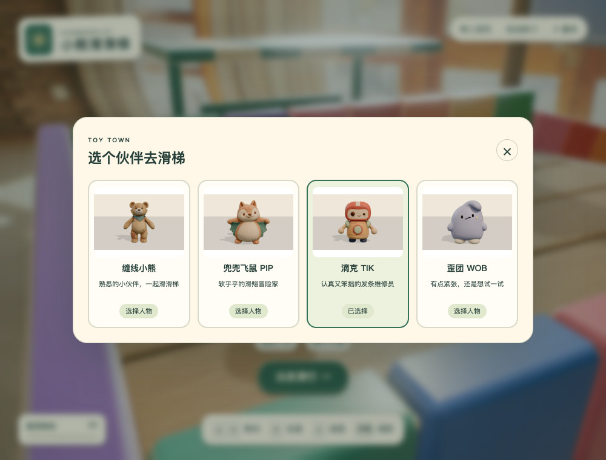

# 玩具城人物模型

三种角色从原创概念单角色参考图经 Hi3D MCP 生成，再用 Blender 精简、修复和绑定。模型生成共 135 积分，任务记录见 [hi3d-tasks.json](hi3d-tasks.json)。

可运行 demo、动作复用、检查范围与重建流程见[接入说明](../../docs/toy-town-model-integration.zh-CN.md)。动画 GLB 与人物缩略图位于 [`teddy-playground/dist/characters/`](../../teddy-playground/dist/characters/)，运行时无需读取本目录。

| 角色 | 静态游戏网格 | Hi3D 原模型 | 四方向检查 |
|---|---|---|---|
| 兜兜飞鼠 PIP | [pip-game.glb](pip-game.glb) | [模型页](https://www.hi3d.ai/3d-model/c7e67ae289454e80a8221774c469b914) | [检查图](pip-review.png) |
| 滴克 TIK | [tik-game.glb](tik-game.glb) | [模型页](https://www.hi3d.ai/3d-model/2cbf0120e832472c90b46638b1ddaaa4) | [检查图](tik-review.png) |
| 歪团 WOB | [wob-game.glb](wob-game.glb) | [模型页](https://www.hi3d.ai/3d-model/091bd72af5d1482ca821eae096f8b059) | [检查图](wob-review.png) |

- `references/`：建模使用的单角色参考图；没有将整张多视图设计板直接送入建模。
- `originals/`：未修改的 Hi3D 原始 GLB，每个约 200 万三角面。
- `*-source.json`：来源、生成参数与稳定模型页。
- `*-game.inspection.json`：静态检查、修复及动作审阅记录。
- `model-checks.json`：最终动画 GLB 的结构检查结果。
- `*-slide-review.png`：滑行姿态检查图；该独立检查工具的固定地面没有使用游戏中的坐姿接触补偿，实际接地以 demo 为准。

