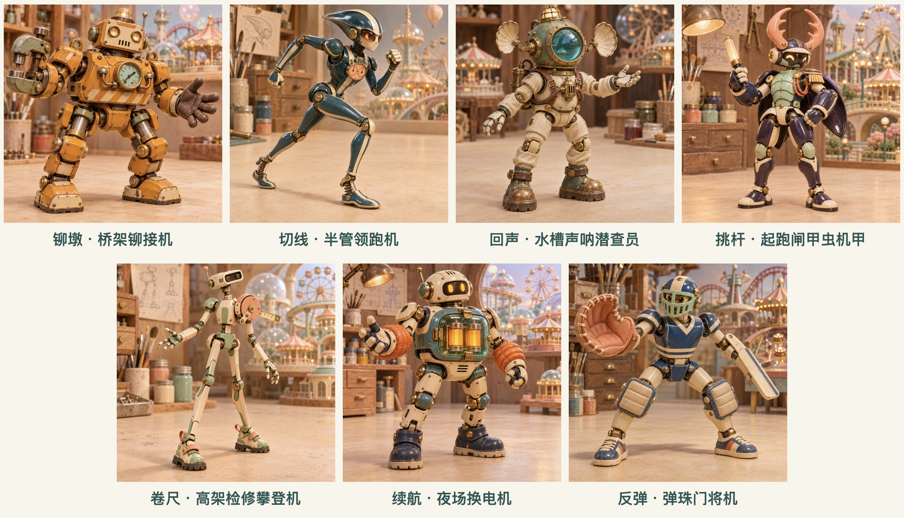
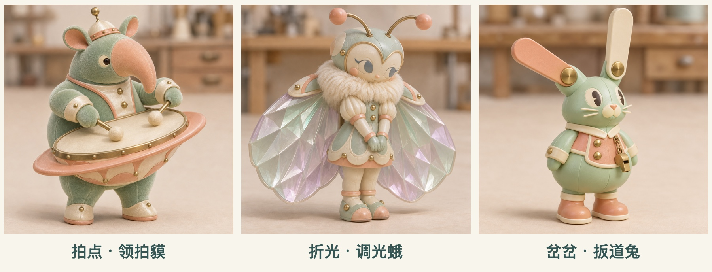

# 玩具城 · 二十只玩偶

从角色名进入设定卡。每个角色目录中的 README.md 记录当前文字设定，十只角色均可在小熊滑滑梯中选择。各卡片收录视觉基准、建模记录与分阶段模型。

## 泡泡星港 · 机器人班组

七款双足机器人已生成桌面高模。可在[桌面预览](robots-desktop.html)逐个旋转角色、查看九段基础动作和专属机构动作。[七款实模动作总览](bubbleport-desktop-review.jpg)

本地浏览时从项目根目录运行 `python3 -m http.server 58731`，再打开 `/assets/toy-town-personas/robots-desktop.html`。各角色文件夹内的 `models/original.glb` 为 Hi3D 原始输出，`models/desktop.glb` 为绑定成品。[高模绑定脚本](../../tools/build-bubbleport-robots.py)

| 角色 | 园中岗位 | 造型与动态 |
|---|---|---|
| [铆墩](rivet-press/README.md) | 桥架铆接机 | [三视图](rivet-press/references/turnaround-v1.png) · [锁紧压钳](rivet-press/references/motion-v2.png) |
| [切线](apex-pacer/README.md) | 半管领跑机 | [跑姿多视图](apex-pacer/references/turnaround-v2.png) · [弹簧鞋跟](apex-pacer/references/motion-v2.png) |
| [回声](echo-diver/README.md) | 水槽声呐潜查员 | [三视图](echo-diver/references/turnaround-v2.png) · [听音盘开合](echo-diver/references/motion-v1.png) |
| [挑杆](signal-beetle/README.md) | 起跑闸甲虫机甲 | [三视图](signal-beetle/references/turnaround-v1.png) · [背甲发令](signal-beetle/references/motion-v2.png) |
| [卷尺](reel-climber/README.md) | 高架检修攀登机 | [三视图](reel-climber/references/turnaround-v3.png) · [量带伸缩](reel-climber/references/motion-v1.png) |
| [续航](arc-keeper/README.md) | 夜场换电机 | [三视图](arc-keeper/references/turnaround-v1.png) · [双芯灯态](arc-keeper/references/motion-v1.png) |
| [反弹](ratchet-goalie/README.md) | 弹珠门将机 | [四视图](ratchet-goalie/references/turnaround-v3.png) · [挡球与接球](ratchet-goalie/references/motion-v1.png) |

## 泡泡星港 · 三位乐园居民

薄荷色透明半管、蜜桃色土星鼓壁和桥底暖灯来自泡泡星港的微缩赛道原案。本系列要求角色具备直立的人型躯干、两条手臂和可交替承重行走的双腿。点角色名可查看独立概念图、动作设定和待验证细节。

| 角色 | 园中岗位 |
|---|---|
| [拍点](orbit-tapir/README.md) | 土星鼓壁的领拍貘 |
| [折光](prism-moth/README.md) | 穹顶灯室的调光蛾 |
| [岔岔](switch-hare/README.md) | 三路岔道的扳道兔 |

[本系列的玩具市场调研](../../docs/bubbleport-toy-research.zh-CN.md)

[查看游戏内十角色选角画面](demo-picker.jpg)

## 按玩家动机设计的六只玩偶

| 角色 | 主要玩家动机 |
|---|---|
| [阿扣 · 旧雨衣小鸭](duck/README.md) | 陪伴 |
| [翻面 · 双面亮片鳐](ray/README.md) | 自我表达 |
| [碰铃 · 半副镲片小象](elephant/README.md) | 社交互动 |
| [准星 · 水平仪壁虎](gecko/README.md) | 操控反馈 |
| [一圈 · 滚章小刺猬](hedgehog/README.md) | 机关探索 |
| [屉屉 · 标本柜寄居蟹](crab/README.md) | 收藏陈列 |

## 初代游戏角色

| 角色 | 定位 |
|---|---|
| [兜兜飞鼠 PIP](pip/README.md) | 毛绒滑翔冒险家 |
| [滴克 TIK](tik/README.md) | 发条维修员 |
| [歪团 WOB](wob/README.md) | 努力装镇定的软胶团子 |
| [缝线小熊](teddy/README.md) | 经典滑梯的毛绒伙伴 |

## 共用设定

原有十只角色属于微缩木制玩具城。按玩家动机设计的六只玩偶在首版中假设速度、碰撞范围和落地时机一致，角色差异通过轮廓、材质、个性与动作表现。

## 如何更新

修改角色时，同步更新设定卡对应段落，并在变更记录追加日期、版本和改动原因。新图按 concept-v2.png、concept-v3.png 递增保存，把卡片内的预览指向当前采用版本。文字与图像有出入时，先记入「待验证」并写明两种表现，确认后再同步更新。
