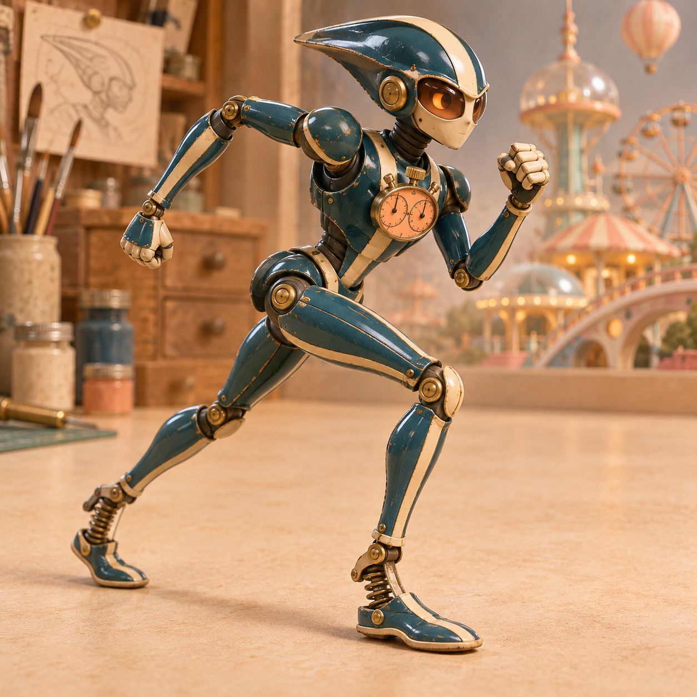
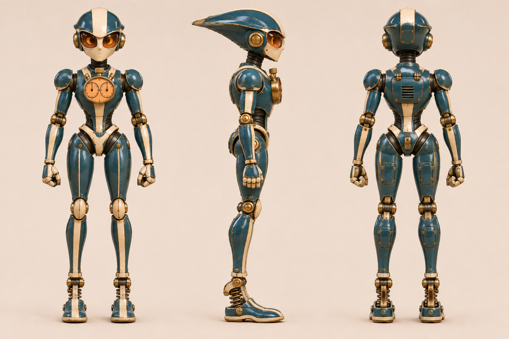
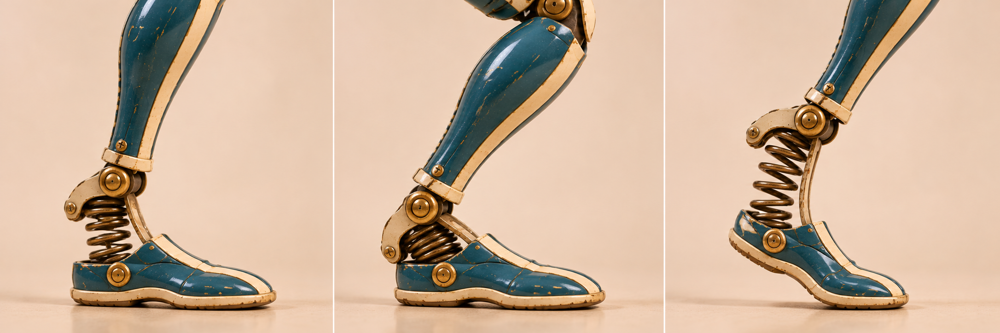

# 切线 · 半管领跑机

[返回玩偶库](../README.md)

它专挑半管最紧的弯试跑。胸前的双针秒表分别记录进弯和出弯，跑完才肯看成绩。

## 步态与动作

长腿交替蹬地，进弯收短内侧步，出弯时弹簧鞋跟伸展。

## 正面、侧面与背面

## 弹簧鞋跟

| 左格 | 中格 | 右格 |
|---|---|---|
| 触地／脚跟先接触地面，弹簧保留间隙 | 承重／踝部下沉，线圈间距收窄 | 蹬离／前掌支地、鞋跟抬起，弹簧回伸 |

鞋跟弹簧沿支柱压缩。抬跟时脚掌绕前掌接地点转动。

## 待验证

侧后视角能否同时读出前倾身姿和后脚蹬地？

## 变更记录

2026-11-08 · v1 · 收录首版概念图与步态设定。

2026-11-08 · v1.1 · 收录全身三视图与三阶段动态设定。
