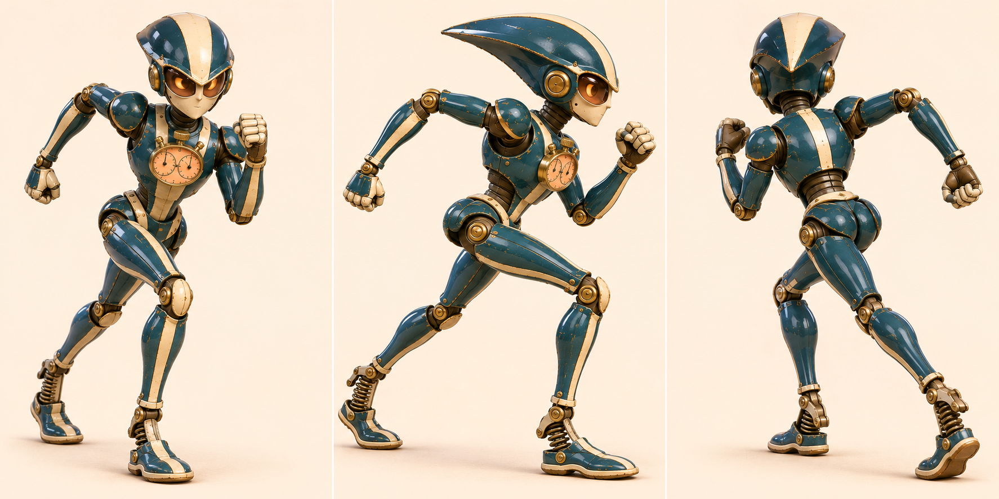
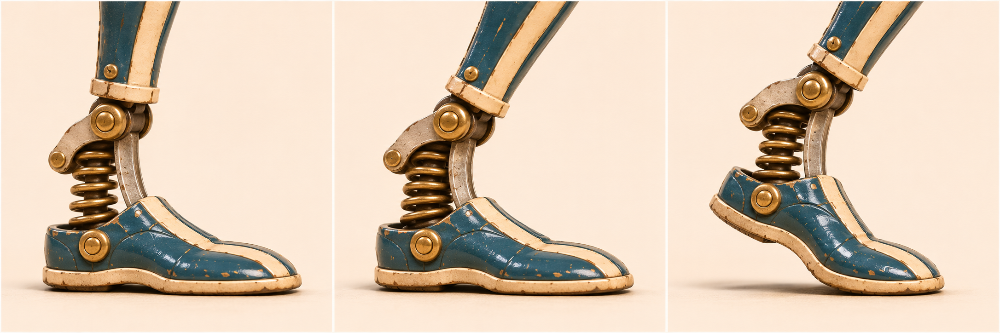

# 切线 · 半管领跑机

[返回玩偶库](../README.md)

它专挑半管最紧的弯试跑。胸前的双针秒表分别记录进弯和出弯，跑完才肯看成绩。

## 步态与动作

长腿交替蹬地，进弯收短内侧步，出弯时弹簧鞋跟伸展。

## 跑姿多视图

## 弹簧鞋跟

| 左格 | 中格 | 右格 |
|---|---|---|
| 触地／脚跟先接触地面，弹簧保留间隙 | 承重／踝部轻微下沉，弹簧小幅压缩 | 蹬离／前掌支地、鞋跟抬起，弹簧回伸 |

鞋跟弹簧沿支柱压缩。抬跟时脚掌绕前掌接地点转动。

## 首图复核

跑姿多视图以首图的尖收额纹、下压眼缘和尖下颌为准。鞋跟采用小行程压缩；原图看不出止挡和导向，打样时需验证踝侧连杆的两轴距离和弹簧余量。

## 待验证

侧后视角能否同时读出前倾身姿和后脚蹬地？

## 桌面高模

[桌面模型与动作预览](../robots-desktop.html?id=apex-pacer) · [带动作的桌面 GLB](models/desktop.glb) · [原始 GLB](models/original.glb) · [Hi3D 模型页](https://www.hi3d.ai/3d-model/d72724ca9035480e91d0e9e5a262913a)

原始网格 2,000,000 个三角面。桌面成品 2,000,000 个三角面、66.5 MiB，保留两张 8192 × 8192 原始贴图。基础动作沿用小熊的九个片段名与时长，另有 弹簧鞋跟（HeelSpring）。

以首张跑姿为绑定基姿，鞋跟绕前掌抬起，弹簧作小幅压缩。

[站姿实模](records/desktop-rest.jpg) · [专属动作实模](records/desktop-action.jpg) · [规格](records/desktop.json) · [生成记录](records/hi3d.json)

## 变更记录

2026-11-08 · v1 · 收录首版概念图与步态设定。

2026-11-08 · v1.1 · 收录跑姿多视图与三阶段动态设定。

2026-11-08 · v1.2 · 更新派生设定板并对照首图复检。
