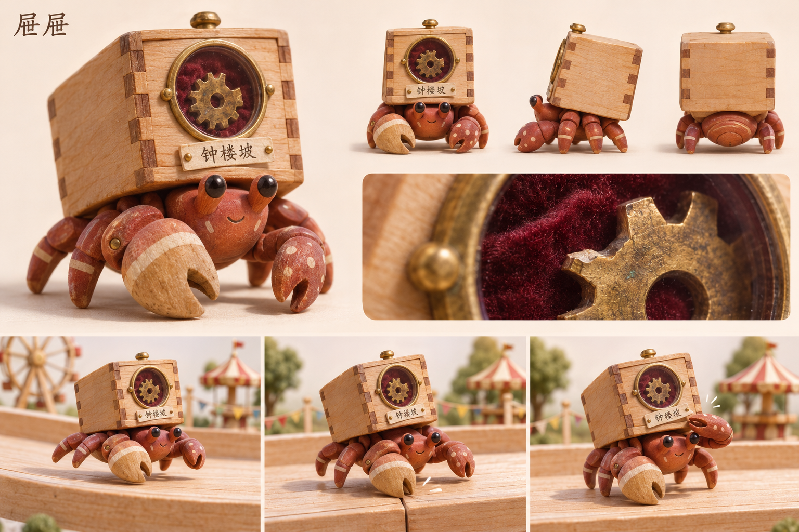

# 屉屉 · 标本柜寄居蟹

[返回角色索引](../README.md)

## 角色定位

**收藏陈列。** 每件藏品关联一段赛道记忆，抽屉能排成一座个人藏品柜。

## 外形与材质

陶土红寄居蟹，双钳一大一小。壳是浅木抽屉，透明圆窗下有地点纸签。初始藏品是绒布槽中的一枚缺齿黄铜齿轮，纸签写「钟楼坡」。

## 动作与赛道反馈

侧身小步横移，越过板缝时藏品在槽内微晃；刹停后伸钳把纸签抹平。

## 改款时保留

每屉一物一地点。扩展藏品时一并记录物件、出处和标签；保留圆窗与可并排陈列的抽屉轮廓。

## 待验证

图中圆窗与脸同侧，文字设定希望玩家从追尾视角看到藏品。木柜和身体的相对朝向待游戏镜头测试后确定。

## 游戏模型

[建模输入](references/hi3d-input.jpg) · [Hi3D 生成记录](records/source.json) · [四方向检查](records/review.png) · [游戏起点实拍](records/demo-start.jpg)

| 阶段 | 文件 |
|---|---|
| Hi3D 原始模型 | [original.glb](models/original.glb) |
| 游戏静态模型 | [game.glb](models/game.glb) |
| 已绑定的游戏模型 | [animated.glb](models/animated.glb) |

游戏版有九段动作。模型面数、贴图和动作时长见[导出检查](records/animation-check.json)。

当前圆窗与脸同侧，正面能看到齿轮，背面为木壳。追尾视角下的展示窗朝向仍待调整。

## 变更记录

| 日期 | 版本 | 设定变更 |
|---|---|---|
| 2026-11-08 | v1 | 收录首版角色提案与概念设定板。 |
| 2026-11-08 | 游戏模型 v1 | 从首版设定图生成 Hi3D 模型，完成精简和竞速动作绑定。 |
