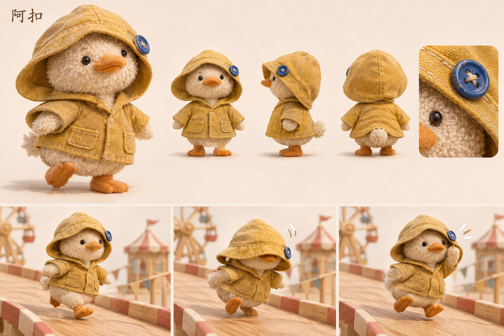

# 阿扣 · 旧雨衣小鸭

[返回角色索引](../README.md)

## 角色定位

**陪伴。** 想反复带同一个伙伴上场，熟悉它的小习惯。

## 外形与材质

燕麦色毛巾布、黑豆眼、芥黄色旧雨衣。帽子略大，蓝扣固定在角色自己的左帽檐；背面能看到短鸭尾。

## 动作与赛道反馈

下坡时脚步快，衣摆慢半拍。经过板缝，松的一侧帽檐滑下，阿扣边跑边用翅膀顶回去。

## 改款时保留

后续雨衣款式可以变化；蓝扣的位置、单侧松帽檐和扶帽动作要能对应起来。

## 待验证

追尾视角能否看清扶帽动作和蓝扣？

## 游戏模型

[建模输入](references/hi3d-input.jpg) · [Hi3D 生成记录](records/source.json) · [四方向检查](records/review.png) · [游戏起点实拍](records/demo-start.jpg)

| 阶段 | 文件 |
|---|---|
| Hi3D 原始模型 | [original.glb](models/original.glb) |
| 游戏静态模型 | [game.glb](models/game.glb) |
| 已绑定的游戏模型 | [animated.glb](models/animated.glb) |

游戏版有九段动作。模型面数、贴图和动作时长见[导出检查](records/animation-check.json)。

当前模型的雨帽与外套在日光下较有光泽，尾部也比设定板突出。后续改款仍以设定板的短鸭尾和旧布质感为基准。

## 变更记录

| 日期 | 版本 | 设定变更 |
|---|---|---|
| 2026-11-08 | v1 | 收录首版角色提案与概念设定板。 |
| 2026-11-08 | 游戏模型 v1 | 从首版设定图生成 Hi3D 模型，完成精简和竞速动作绑定。 |
