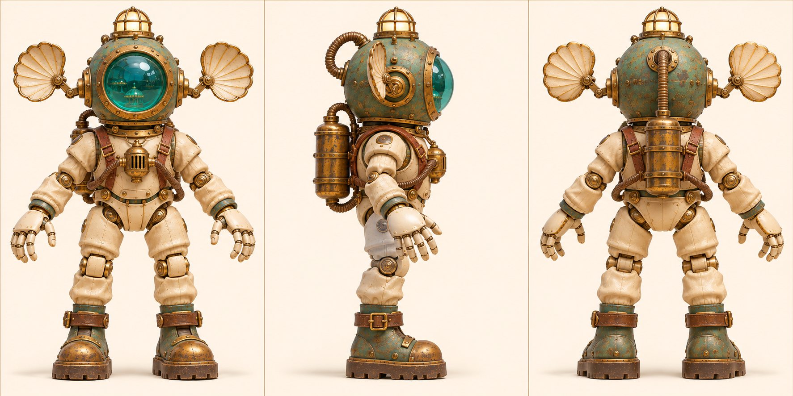
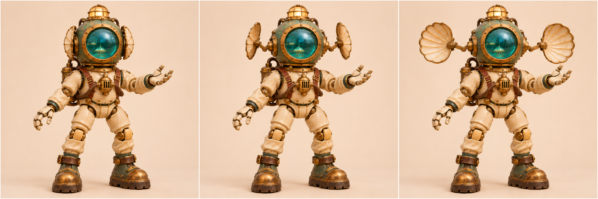

# 回声 · 水槽声呐潜查员

[返回玩偶库](../README.md)

它沿透明水槽底部步行，停下时张开头盔两侧的听音盘，循着回声找到漏水的接缝。

## 步态与动作

两脚轮流抬高跨过管道，停稳后才打开听音盘。

## 正面、侧面与背面

## 听音盘开合

| 左格 | 中格 | 右格 |
|---|---|---|
| 巡检／听音盘靠近盔侧 | 搜索／两侧短臂同步向外展开一半 | 定位／短臂完全展开，盘面对准声源 |

双侧转轴位于头盔耳座。展开时先让盘缘避开肩甲。

## 首图复核

手背采用整片象牙白护甲，原图张开的手有四指与一根对生拇指。背罐在原图从角色右侧露出，后视图的居中挂点属于推定，需用实模核对。

## 待验证

展开听音盘后仍应能看清两肩和双手。

## 桌面高模

[桌面模型与动作预览](../robots-desktop.html?id=echo-diver) · [带动作的桌面 GLB](models/desktop.glb) · [原始 GLB](models/original.glb) · [Hi3D 模型页](https://www.hi3d.ai/3d-model/13b95e85da9a4966993854daffffd37b)

原始网格 1,990,436 个三角面。桌面成品 1,990,436 个三角面、67.1 MiB，保留两张 8192 × 8192 原始贴图。基础动作沿用小熊的九个片段名与时长，另有 双侧听音盘（Listen）。

两片听音盘分别绕盔侧轴转动。

[站姿实模](records/desktop-rest.jpg) · [专属动作实模](records/desktop-action.jpg) · [规格](records/desktop.json) · [生成记录](records/hi3d.json)

## 变更记录

2026-11-08 · v1 · 收录首版概念图与步态设定。

2026-11-08 · v1.1 · 收录全身三视图与三阶段动态设定。

2026-11-08 · v1.2 · 更新派生设定板并对照首图复检。
