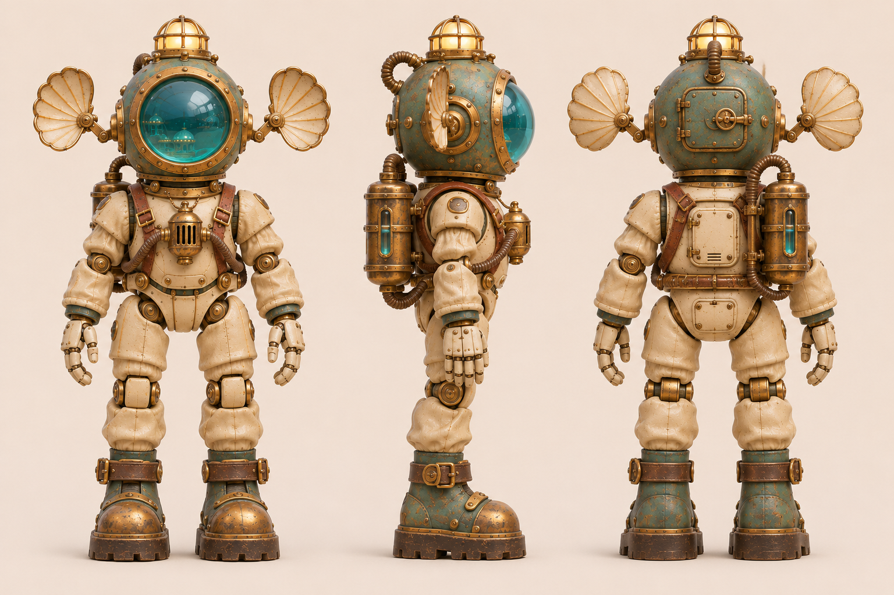

# 回声 · 水槽声呐潜查员

[返回玩偶库](../README.md)

它沿透明水槽底部步行，停下时张开头盔两侧的听音盘，循着回声找到漏水的接缝。

## 步态与动作

两脚轮流抬高跨过管道，停稳后才打开听音盘。

## 正面、侧面与背面

## 听音盘开合

| 左格 | 中格 | 右格 |
|---|---|---|
| 巡检／听音盘靠近盔侧 | 搜索／两侧短臂同步向外展开一半 | 定位／短臂完全展开，盘面对准声源 |

双侧转轴位于头盔耳座。展开时先让盘缘避开肩甲。

## 待验证

展开听音盘后仍应能看清两肩和双手。

## 变更记录

2026-11-08 · v1 · 收录首版概念图与步态设定。

2026-11-08 · v1.1 · 收录全身三视图与三阶段动态设定。
