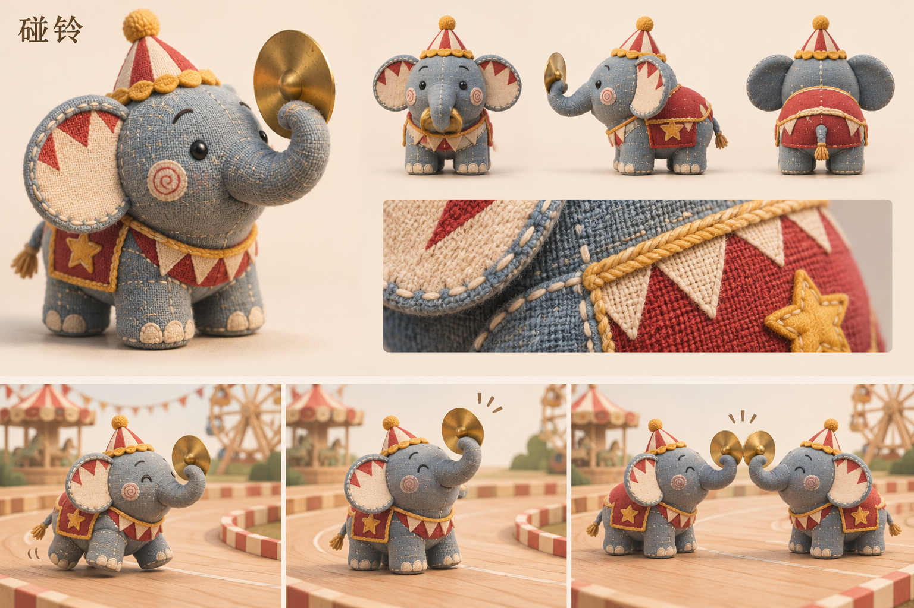

# 碰铃 · 半副镲片小象

[返回角色索引](../README.md)

## 角色定位

**社交互动。** 朋友能用另一半镲回应它的邀请，一起完成开场招呼。

## 外形与材质

矮胖蓝灰布象，四条短腿，鼻尖卷着一片黄铜镲。图中有马戏团尖帽、织物围领和鞍布。

## 动作与赛道反馈

走动时象鼻配合步子托住镲；发车前举镲等待。两只碰铃各持一片相碰，其他角色也可用招呼动作回应。

## 改款时保留

装饰可换；单只只持一片镲，鼻尖握镲与等待回应的姿势是识别重点。

## 待验证

不同身高的搭档如何对齐招呼动作？

## 游戏模型

[建模输入](references/hi3d-input.jpg) · [Hi3D 生成记录](records/source.json) · [四方向检查](records/review.png) · [游戏起点实拍](records/demo-start.jpg)

| 阶段 | 文件 |
|---|---|
| Hi3D 原始模型 | [original.glb](models/original.glb) |
| 游戏静态模型 | [game.glb](models/game.glb) |
| 已绑定的游戏模型 | [animated.glb](models/animated.glb) |

游戏版有九段动作。模型面数、贴图和动作时长见[导出检查](records/animation-check.json)。

## 变更记录

| 日期 | 版本 | 设定变更 |
|---|---|---|
| 2026-11-08 | v1 | 收录首版角色提案与概念设定板。 |
| 2026-11-08 | 游戏模型 v1 | 从首版设定图生成 Hi3D 模型，完成精简和竞速动作绑定。 |
