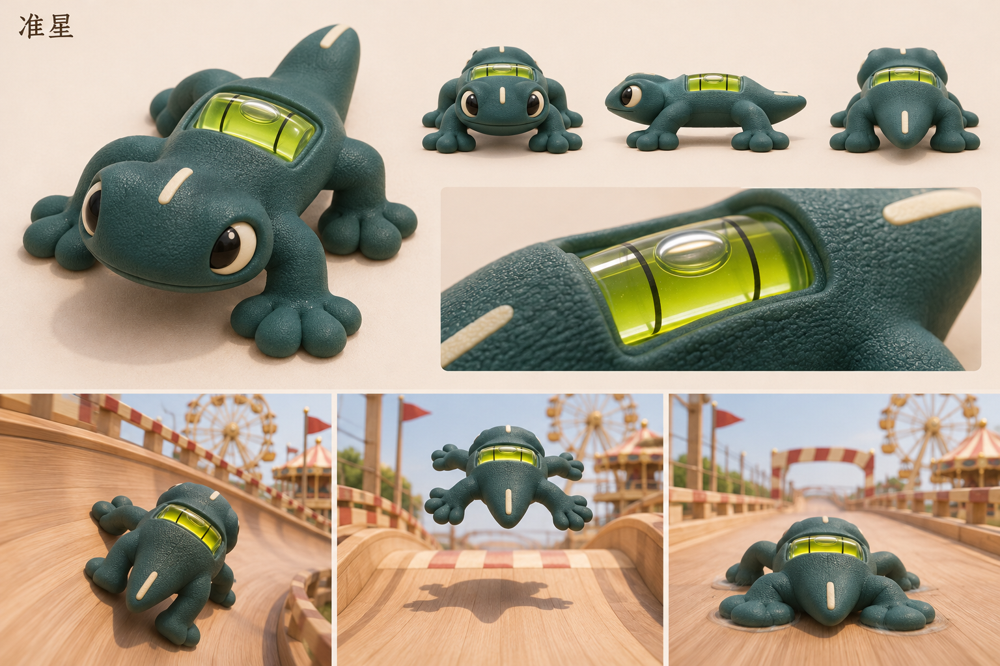

# 准星 · 水平仪壁虎

[返回角色索引](../README.md)

## 角色定位

**操控反馈。** 能从背线、气泡和脚掌判断朝向、倾斜与着地时机。

## 外形与材质

深青色模压橡胶，扁头短尾、四只宽脚掌。背部横嵌黄绿色水平管，管内一颗气泡，鼻尖与尾部各有乳白刻线。

## 动作与赛道反馈

压弯时气泡移向抬高的一侧；腾空时四掌张开，触地瞬间掌垫同时压扁，伴随短促落地声。

## 改款时保留

水平管沿左右方向安装。检查转向与落地反馈时优先使用玩家的追尾视角。

## 待验证

背管在小屏上的最小可读尺寸是多少？

## 游戏模型

[建模输入](references/hi3d-input.jpg) · [Hi3D 生成记录](records/source.json) · [四方向检查](records/review.png) · [游戏起点实拍](records/demo-start.jpg)

| 阶段 | 文件 |
|---|---|
| Hi3D 原始模型 | [original.glb](models/original.glb) |
| 游戏静态模型 | [game.glb](models/game.glb) |
| 已绑定的游戏模型 | [animated.glb](models/animated.glb) |

游戏版有九段动作。模型面数、贴图和动作时长见[导出检查](records/animation-check.json)。

## 变更记录

| 日期 | 版本 | 设定变更 |
|---|---|---|
| 2026-11-08 | v1 | 收录首版角色提案与概念设定板。 |
| 2026-11-08 | 游戏模型 v1 | 从首版设定图生成 Hi3D 模型，完成精简和竞速动作绑定。 |
