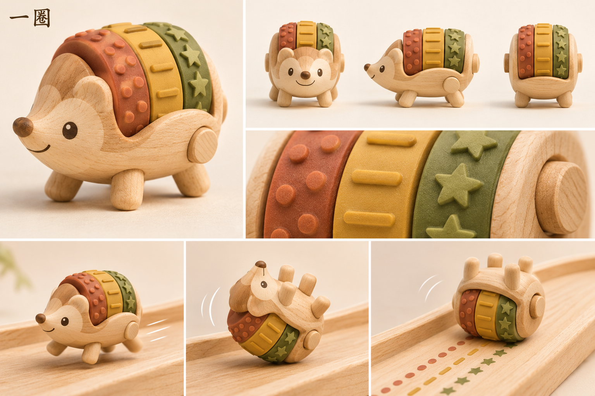

# 一圈 · 滚章小刺猬

[返回角色索引](../README.md)

## 角色定位

**机关探索。** 通过重跑和改变着地角度，观察滚章接地与印迹之间的关系。

## 外形与材质

浅枫木刺猬，四只木脚。三枚橡胶滚章沿同一根横轴并排，端部露出轴帽。设定图用橙红圆点、赭黄短杠、橄榄绿星星区分三圈。

## 动作与赛道反馈

平地用脚跑，陡坡收脚翻身，靠背上的滚章下坡。直落印三排，斜落时先接地的一圈先留印。

## 改款时保留

保持三轮与三种印迹逐一对应。由滚章接地留下的痕迹逐渐淡去，不改变抓地力。

## 待验证

斜落地时，两侧印迹起点差多少才看得清？

## 游戏模型

[建模输入](references/hi3d-input.jpg) · [Hi3D 生成记录](records/source.json) · [四方向检查](records/review.png) · [游戏起点实拍](records/demo-start.jpg)

| 阶段 | 文件 |
|---|---|
| Hi3D 原始模型 | [original.glb](models/original.glb) |
| 游戏静态模型 | [game.glb](models/game.glb) |
| 已绑定的游戏模型 | [animated.glb](models/animated.glb) |

游戏版有九段动作。模型面数、贴图和动作时长见[导出检查](records/animation-check.json)。

当前游戏版用翻身动作让滚章接地。检查图中三种纹带沿头尾方向排列；后续精修需调整为设定板中的横向并列结构。可对照[滑行姿势](records/slide.png)。

## 变更记录

| 日期 | 版本 | 设定变更 |
|---|---|---|
| 2026-11-08 | v1 | 收录首版角色提案与概念设定板。 |
| 2026-11-08 | 游戏模型 v1 | 从首版设定图生成 Hi3D 模型，完成精简和竞速动作绑定。 |
