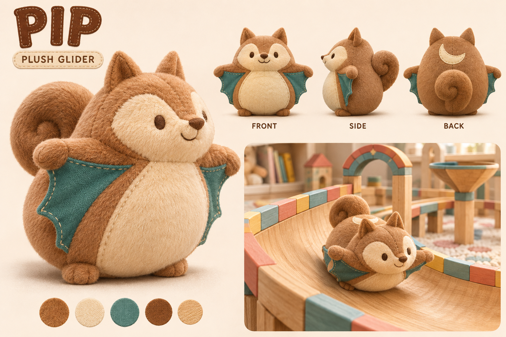

# 兜兜飞鼠 PIP

[返回角色总索引](../README.md)

## 角色定位

毛绒滑翔冒险家。已收录在[游戏角色清单](../../../teddy-playground/dist/slide/characters.json)。

## 外形与材质

榛果色短绒、奶油脸肚、青绿翼膜和贴背卷尾。

## 动作与赛道反馈

跳跃时小幅摆翼；模型收紧卷尾厚度，减少头部独立扭动以保护头身衔接。

## 建模记录与模型

[原始设计提案](../../../docs/toy-design-plush.zh-CN.md) · [单角色建模输入](references/model-input.png) · [来源参数](records/source.json) · [修整记录](records/game.inspection.json) · [四方向检查](records/review.png) · [滑行检查](records/slide-review.png)

[生成任务总表](records/hi3d-tasks.json)与[动画检查总表](records/model-checks.json)保留三角色共同的建模批次。

| 阶段 | 文件 |
|---|---|
| 原始模型 | [original.glb](models/original.glb) |
| 精简静态网格 | [game.glb](models/game.glb) |
| 已绑定动画 | [animated.glb](models/animated.glb) |

[选角头像](references/picker.jpg) · [共用动作与接入流程](../../../docs/toy-town-model-integration.zh-CN.md)

## 改款时保留与待验证

改款时从追尾镜头复查翼膜和卷尾的辨识度。

## 变更记录

| 日期 | 版本 | 设定变更 |
|---|---|---|
| 2026-11-08 | v1 | 归档现有视觉参考、建模记录与三阶段模型。 |
