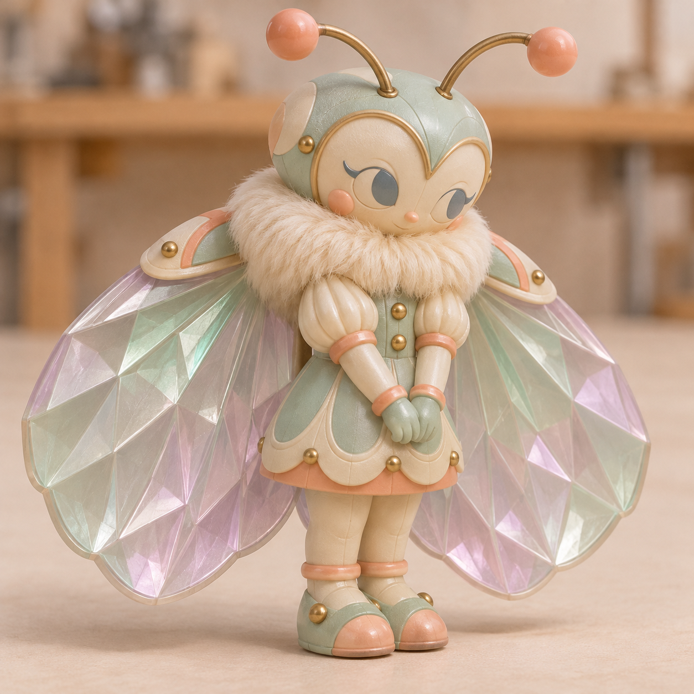

# 折光 · 穹顶灯室的调光蛾

[返回玩偶库](../README.md)

它在亮灯前最后一个离开灯室。合拢的两扇棱镜翅贴在绒背上，像两片磨出切面的窗。

## 动作设定

双腿交替迈步，走出桥底时展开棱镜翅调光。双翅打开一指宽时，淡紫色内缘从背后显出来。

## 待验证

翅膀闭合时也要保留扇形切面。

## 变更记录

2026-11-08 · v1 · 收录泡泡星港系列首版概念图与角色设定。

2026-11-08 · v1.1 · 明确双腿步态。
