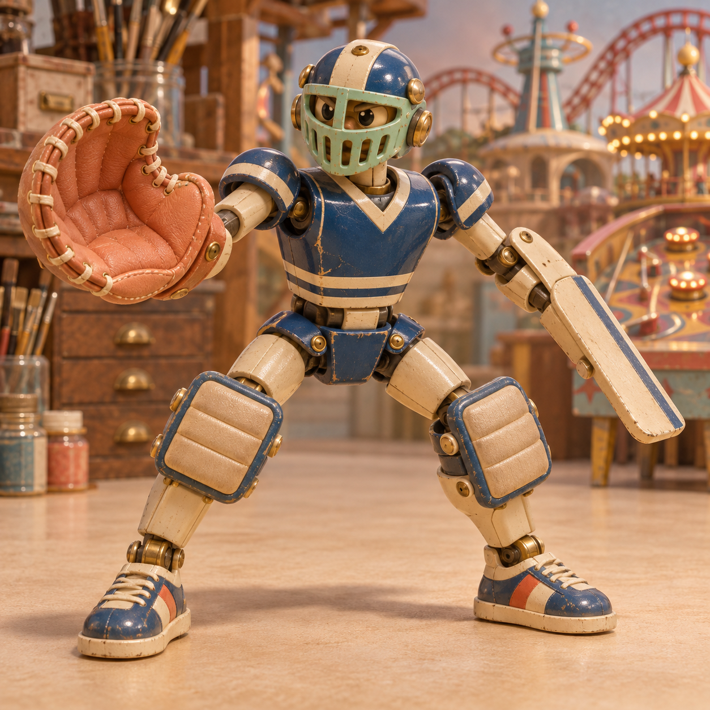
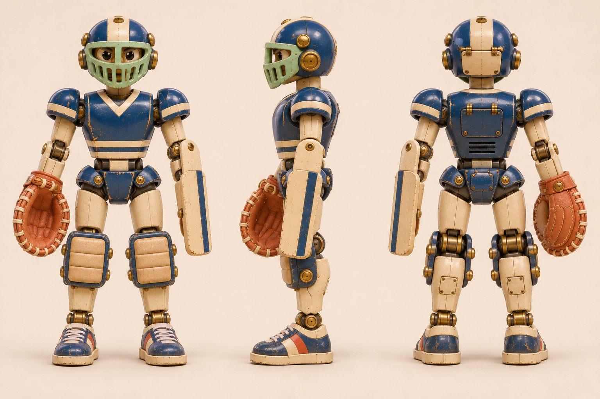
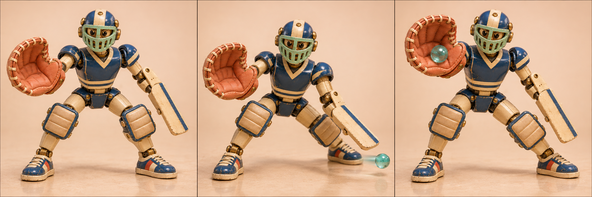

# 反弹 · 弹珠门将机

[返回玩偶库](../README.md)

它是弹珠游戏摊的守门员。弹珠碰到挡板会发出脆响，它听声侧跨一步，用另一侧的大手套接住回弹。

## 步态与动作

屈膝横向侧步，接球后双脚依次回到门线。

## 正面、侧面与背面

## 挡球与接球

| 左格 | 中格 | 右格 |
|---|---|---|
| 守线／屈膝分腿，接球手套张开 | 封挡／朝挡板侧横跨一步，前臂转斜迎球 | 回接／重心移向手套侧，手套抬起兜住回弹 |

双膝吸收横移冲量。板面随前臂转动，手套开合独立控制。

## 待验证

手套与挡板的轮廓要能从球门另一端分辨。

## 变更记录

2026-11-08 · v1 · 收录首版概念图与步态设定。

2026-11-08 · v1.1 · 收录全身三视图与三阶段动态设定。
