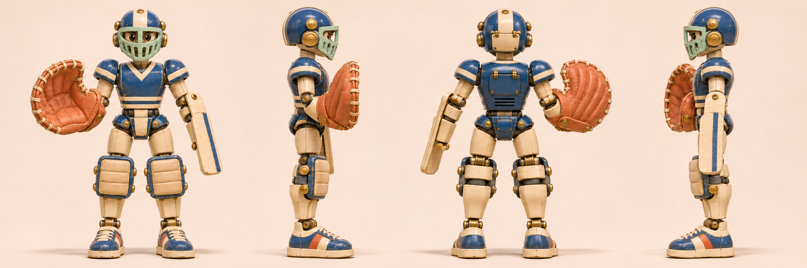

# 反弹 · 弹珠门将机

[返回玩偶库](../README.md)

它是弹珠游戏摊的守门员。弹珠碰到挡板会发出脆响，它听声侧跨一步，用另一侧的大手套接住回弹。

## 步态与动作

屈膝横向侧步，接球后双脚依次回到门线。

## 正面、两侧与背面

## 挡球与接球

| 左格 | 中格 | 右格 |
|---|---|---|
| 守线／屈膝分腿，接球手套张开 | 封挡／朝挡板侧横跨一步，前臂转斜迎球 | 回接／重心移向手套侧，手套抬起兜住回弹 |

双膝吸收横移冲量。板面随前臂转动，手套开合独立控制。

## 首图复核

右臂接球手套保留高指袋、深拇指缺口与较低的腕口，左前臂装挡板。正面裆甲采用首图蓝色，四视图上的奶油色竖条仅为绘制偏差。四视图依次为正面、手套侧、背面、挡板侧。

## 待验证

手套与挡板的轮廓要能从球门另一端分辨。

## 桌面高模

[桌面模型与动作预览](../robots-desktop.html?id=ratchet-goalie) · [带动作的桌面 GLB](models/desktop.glb) · [原始 GLB](models/original.glb) · [Hi3D 模型页](https://www.hi3d.ai/3d-model/6c19264157bb410d89ccc989535b2281)

原始网格 1,986,240 个三角面。桌面成品 1,010,686 个三角面、37.2 MiB，保留两张 8192 × 8192 原始贴图。基础动作沿用小熊的九个片段名与时长，另有 封挡接球（Catch）。

已剔除重复身体，利用原有护膝表面补齐另一侧护具。接球动画另带一颗可见的弹珠。

[站姿实模](records/desktop-rest.jpg) · [专属动作实模](records/desktop-action.jpg) · [规格](records/desktop.json) · [生成记录](records/hi3d.json)

## 变更记录

2026-11-08 · v1 · 收录首版概念图与步态设定。

2026-11-08 · v1.1 · 收录全身四视图与三阶段动态设定。

2026-11-08 · v1.2 · 更新派生设定板并对照首图复检。
