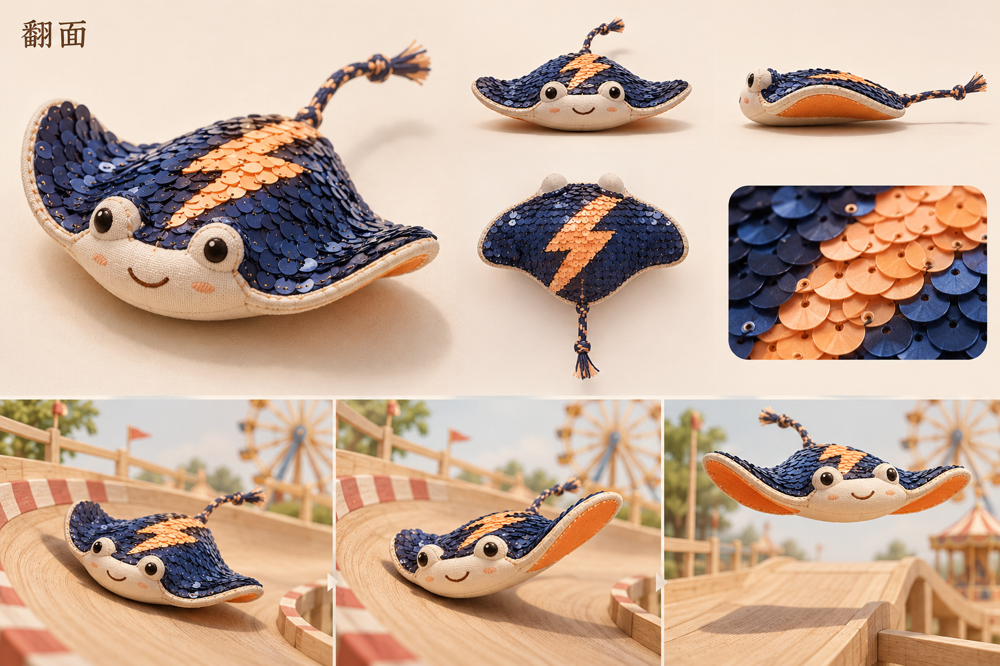

# 翻面 · 双面亮片鳐

[返回角色索引](../README.md)

## 角色定位

**自我表达。** 玩家亲手划出的图案，独自比赛时也能从背面看到。

## 外形与材质

扁平布鳐，两翼宽圆，短尾像鞋带。背面翻转亮片为墨蓝、杏橙两色，翼底为橙色。

## 动作与赛道反馈

贴坡时翼面轻轻起伏，压弯时外侧翼尖抬起，起跳时双翼展开。动作全过程保留玩家的图案。

## 改款时保留

图上的闪电是示例纹路。新增纹路时，保留亮片可翻转的结构和宽阔的背部绘制区域。

## 待验证

赛道镜头下，多粗的手划线仍能看清？

## 游戏模型

[建模输入](references/hi3d-input.jpg) · [Hi3D 生成记录](records/source.json) · [四方向检查](records/review.png) · [游戏起点实拍](records/demo-start.jpg)

| 阶段 | 文件 |
|---|---|
| Hi3D 原始模型 | [original.glb](models/original.glb) |
| 游戏静态模型 | [game.glb](models/game.glb) |
| 已绑定的游戏模型 | [animated.glb](models/animated.glb) |

游戏版有九段动作。模型面数、贴图和动作时长见[导出检查](records/animation-check.json)。

## 变更记录

| 日期 | 版本 | 设定变更 |
|---|---|---|
| 2026-11-08 | v1 | 收录首版角色提案与概念设定板。 |
| 2026-11-08 | 游戏模型 v1 | 从首版设定图生成 Hi3D 模型，完成精简和竞速动作绑定。 |
