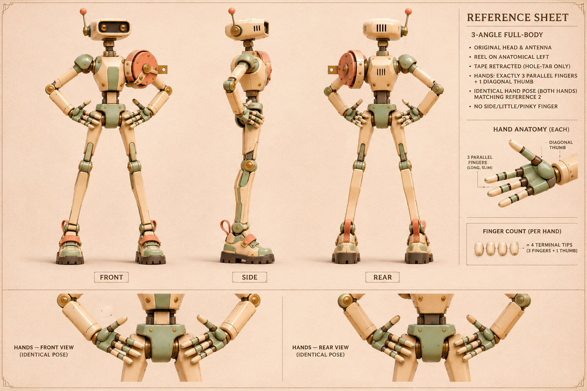

# 卷尺 · 高架检修攀登机

[返回玩偶库](../README.md)

它每上一级检修梯，就从肩上的卷盘拉出一截刻度带，核对相邻桥架有没有沉降。

## 步态与动作

长腿交替跨阶，一只手抓扶栏，另一只手拉尺。

## 正面、侧面与背面

## 量带伸缩

| 左格 | 中格 | 右格 |
|---|---|---|
| 收纳／带孔端片贴近肩部出尺口 | 粗测／尺带短距离伸出 | 复测／继续拉至测点，锁止后读数 |

卷盘绕肩侧轴旋转。尺带沿切向出尺，解锁后按原路径回收。

## 首图复核

双手各有三根并列长指和一根对生拇指。以首图及新版右侧手部放大图为准；底栏掌背特写尚不足以确定手背厚度。量带末端为带孔平片，量产刻度需另行标定。

## 待验证

肩部卷盘与肘关节之间要留出拉尺空间。

## 桌面高模

[桌面模型与动作预览](../robots-desktop.html?id=reel-climber) · [带动作的桌面 GLB](models/desktop.glb) · [原始 GLB](models/original.glb) · [Hi3D 模型页](https://www.hi3d.ai/3d-model/70a730a6acfc4d88ab52da3a6088a0c1)

原始网格 2,000,000 个三角面。桌面成品 2,000,034 个三角面、66.5 MiB，保留两张 8192 × 8192 原始贴图。基础动作沿用小熊的九个片段名与时长，另有 量带伸缩（Measure）。

带孔端片与尺带沿出尺口平移，伸缩过程中刻度间距固定。

[站姿实模](records/desktop-rest.jpg) · [专属动作实模](records/desktop-action.jpg) · [规格](records/desktop.json) · [生成记录](records/hi3d.json)

## 变更记录

2026-11-08 · v1 · 收录首版概念图与步态设定。

2026-11-08 · v1.1 · 收录全身三视图与三阶段动态设定。

2026-11-08 · v1.2 · 更新派生设定板并对照首图复检。
