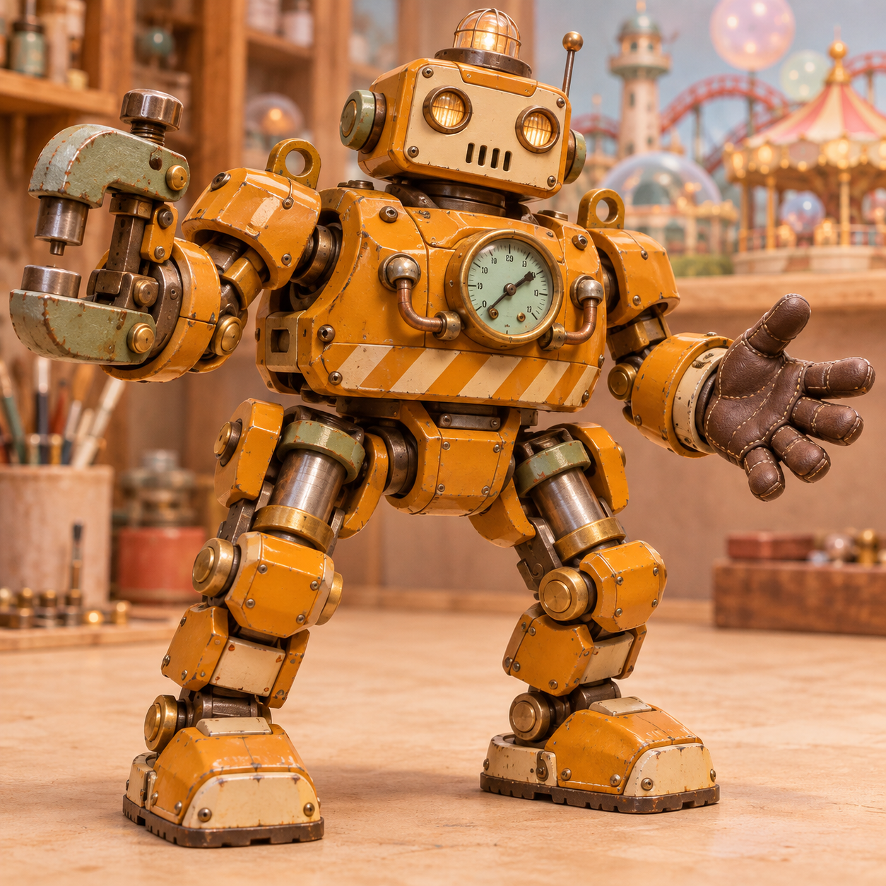
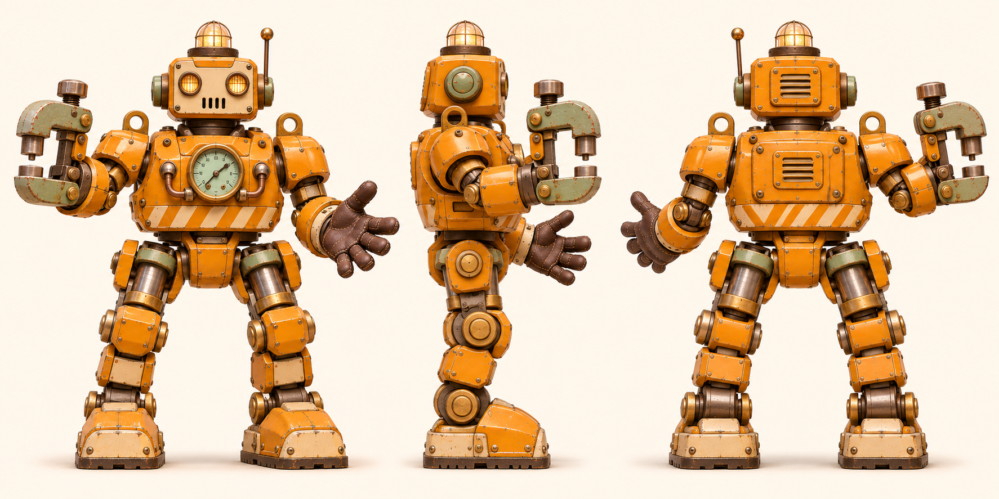
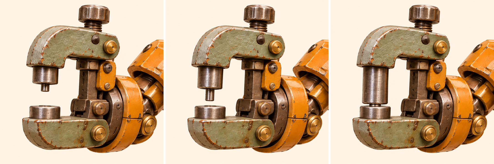

# 铆墩 · 桥架铆接机

[返回玩偶库](../README.md)

它听见桥面接缝发响，就蹲下用左手扶住桥梁，右臂的 C 形压钳合拢，把松动的铆钉压平。

## 步态与动作

短步重踩，走到接缝前双膝下沉。

## 正面、侧面与背面

## 锁紧压钳

| 左格 | 中格 | 右格 |
|---|---|---|
| 张钳待料／上冲头缩回，钳口留满行程 | 定位／上冲头下移半程，对准下砧 | 压铆／上冲头到达下止点，随后退回 |

下砧固定，银色冲头沿钳轴移动。

## 首图复核

右腕压钳的黄铜轴头保持为实心金属件。上下钳架位置固定，只有银色冲头伸向下砧。

## 待验证

压钳闭合时保留两钳口之间的凹槽。

## 桌面高模

[桌面模型与动作预览](../robots-desktop.html?id=rivet-press) · [带动作的桌面 GLB](models/desktop.glb) · [原始 GLB](models/original.glb) · [Hi3D 模型页](https://www.hi3d.ai/3d-model/b1437f31217f46259421b692267707c0)

原始网格 1,987,436 个三角面。桌面成品 1,446,224 个三角面、51.0 MiB，保留两张 8192 × 8192 原始贴图。基础动作沿用小熊的九个片段名与时长，另有 压钳冲头（Rivet）。

已剔除生成时带入的邻视图几何，冲头使用独立控制骨。

[站姿实模](records/desktop-rest.jpg) · [专属动作实模](records/desktop-action.jpg) · [规格](records/desktop.json) · [生成记录](records/hi3d.json)

## 变更记录

2026-11-08 · v1 · 收录首版概念图与步态设定。

2026-11-08 · v1.1 · 收录全身三视图与三阶段动态设定。

2026-11-08 · v1.2 · 更新派生设定板并对照首图复检。
