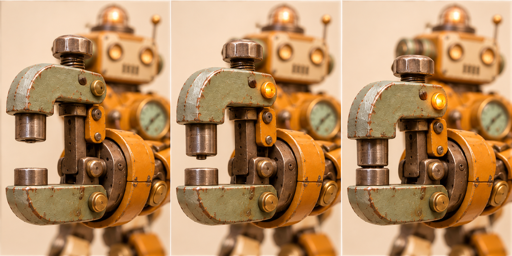

# 铆墩 · 桥架铆接机

[返回玩偶库](../README.md)

它听见桥面接缝发响，就蹲下用左手扶住桥梁，右臂的 C 形压钳合拢，把松动的铆钉压平。

## 步态与动作

短步重踩，走到接缝前双膝下沉。

## 正面、侧面与背面

## 锁紧压钳

| 左格 | 中格 | 右格 |
|---|---|---|
| 张钳待料／上冲头缩回，钳口留满行程 | 定位／上冲头下移半程，对准下砧 | 压铆／上冲头到达下止点，随后退回 |

下砧固定。上钳头沿竖向导轨下降，钳侧的琥珀灯随压合点亮。

## 待验证

压钳闭合时保留两钳口之间的凹槽。

## 变更记录

2026-11-08 · v1 · 收录首版概念图与步态设定。

2026-11-08 · v1.1 · 收录全身三视图与三阶段动态设定。
