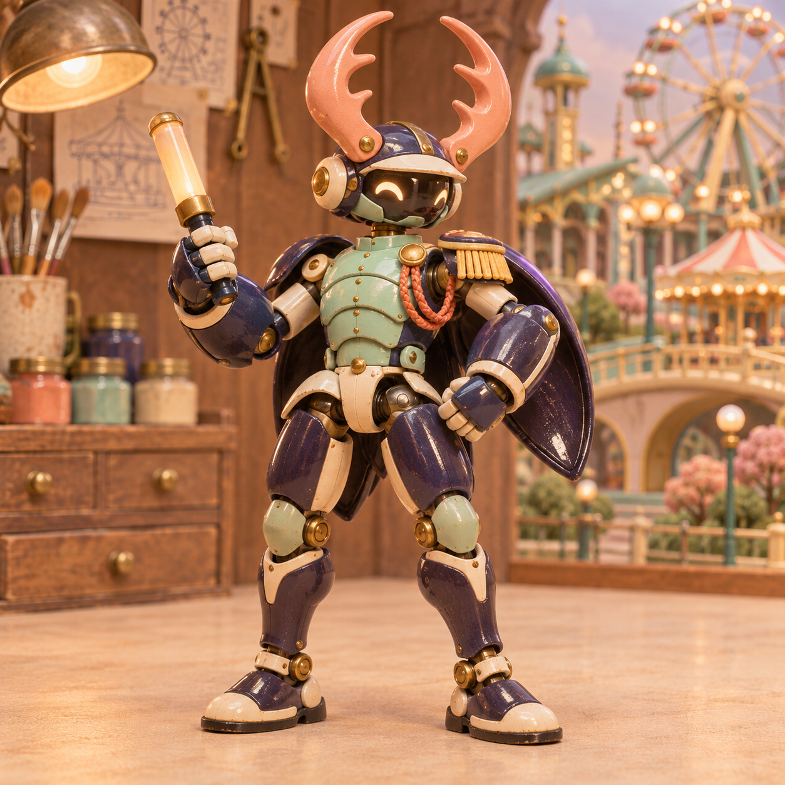
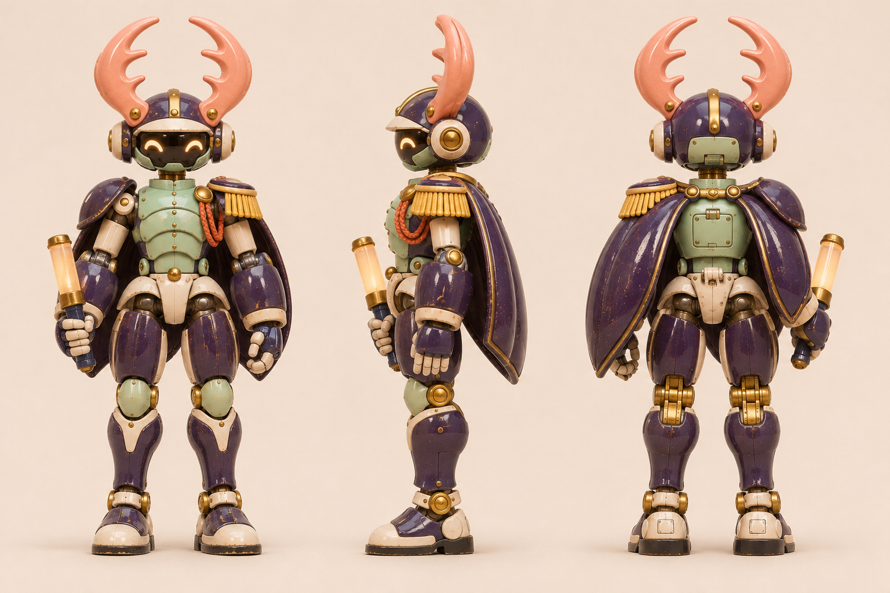
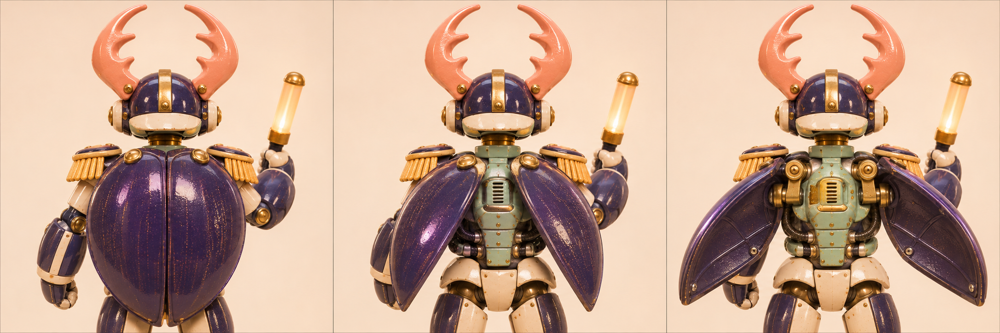

# 挑杆 · 起跑闸甲虫机甲

[返回玩偶库](../README.md)

它先把额前的双叉角卡进闸杆底座，再直起双膝顶起闸杆。背上的靛蓝甲片在发令时啪嗒合拢。

## 步态与动作

平时双足阔步，抬闸时前后脚错开承重。

## 正面、侧面与背面

## 背甲发令

| 左格 | 中格 | 右格 |
|---|---|---|
| 待命／两片背甲沿中缝闭合 | 预备／背甲绕两肩后轴对称张开一半 | 满开／露出背部机构，发令时沿原路快速合拢 |

双叉角固定于头盔。发令动作独立驱动两片背甲。

三视图采用背甲微张的站姿。背部内盖与铰链以动态板满开格为准。

## 待验证

叉角要露出向内的缺口，缩略图中也能看出甲虫形。

## 变更记录

2026-11-08 · v1 · 收录首版概念图与步态设定。

2026-11-08 · v1.1 · 收录全身三视图与三阶段动态设定。
