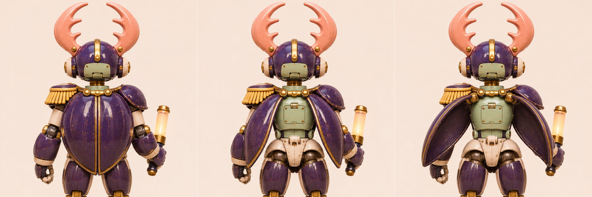

# 挑杆 · 起跑闸甲虫机甲

[返回玩偶库](../README.md)

它先把额前的双叉角卡进闸杆底座，再直起双膝顶起轻质配重闸杆。背上的靛蓝甲片在发令时啪嗒合拢。

## 步态与动作

平时双足阔步，抬闸时前后脚错开承重。

## 正面、侧面与背面

## 背甲发令

| 左格 | 中格 | 右格 |
|---|---|---|
| 待命／两片背甲沿中缝闭合 | 预备／背甲绕两肩后轴对称张开一半 | 满开／露出背部机构，发令时沿原路快速合拢 |

双叉角固定于头盔。发令动作独立驱动两片背甲。

三视图采用背甲微张的站姿。背部内盖与铰链以动态板满开格为准。

## 首图复核

角色左肩有金色流苏，右肩为素色靛蓝甲，右手持发令棒。双角根部的铆点与颈部承力未定，动作按轻质配重闸杆设计。

## 待验证

叉角要露出向内的缺口，缩略图中也能看出甲虫形。

## 桌面高模

[桌面模型与动作预览](../robots-desktop.html?id=signal-beetle) · [带动作的桌面 GLB](models/desktop.glb) · [原始 GLB](models/original.glb) · [Hi3D 模型页](https://www.hi3d.ai/3d-model/6c69c727c7e14e8fb713f58887214cbb)

原始网格 2,000,000 个三角面。桌面成品 2,015,360 个三角面、66.6 MiB，保留两张 8192 × 8192 原始贴图。基础动作沿用小熊的九个片段名与时长，另有 背甲开合（Signal）。

背甲使用独立绑定，背甲下新增检修盖和通风筋。高模两角的分叉与首图有差异。

[站姿实模](records/desktop-rest.jpg) · [专属动作实模](records/desktop-action.jpg) · [规格](records/desktop.json) · [生成记录](records/hi3d.json)

## 变更记录

2026-11-08 · v1 · 收录首版概念图与步态设定。

2026-11-08 · v1.1 · 收录全身三视图与三阶段动态设定。

2026-11-08 · v1.2 · 更新派生设定板并对照首图复检。
