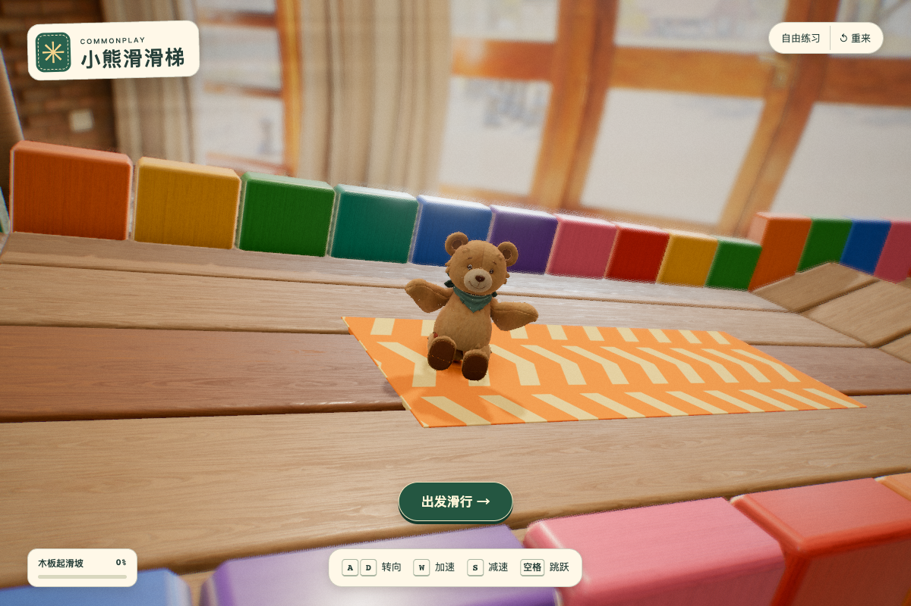

# 缝线小熊

[返回角色总索引](../README.md)

## 角色定位

经典滑梯的毛绒伙伴。已收录在[游戏角色清单](../../../teddy-playground/dist/slide/characters.json)。

## 外形与材质

以现有模型的熊形轮廓、缝线与毛绒渲染为视觉基准。

## 动作与赛道反馈

游戏骨架支持跑、跳、坐下、滑行、起身与终点挥手。其基础动作供其余三只角色重定向使用。

## 建模记录与模型

视觉基准采用已有毛绒效果图。可对照[处理前](records/before.png)、[处理后](records/after.png)与[毛绒效果](records/plush.png)，并检查[轻量化脚本](records/optimize_teddy.py)、[绑骨脚本](records/rig_teddy.py)与[游戏毛绒材质](../../../teddy-playground/dist/slide/plush.js)。

| 阶段 | 文件 |
|---|---|
| 原始模型 | [original.glb](models/original.glb) |
| 精简静态网格 | [game.glb](models/game.glb) |
| 已绑定动画 | [animated.glb](models/animated.glb) |

[选角头像](references/picker.jpg) · [共用动作与接入流程](../../../docs/toy-town-model-integration.zh-CN.md)

## 改款时保留与待验证

修改模型或毛绒材质时，沿用现有对比图机位检查轮廓和表面。

## 变更记录

| 日期 | 版本 | 设定变更 |
|---|---|---|
| 2026-11-08 | v1 | 归档现有视觉参考、建模记录与三阶段模型。 |
