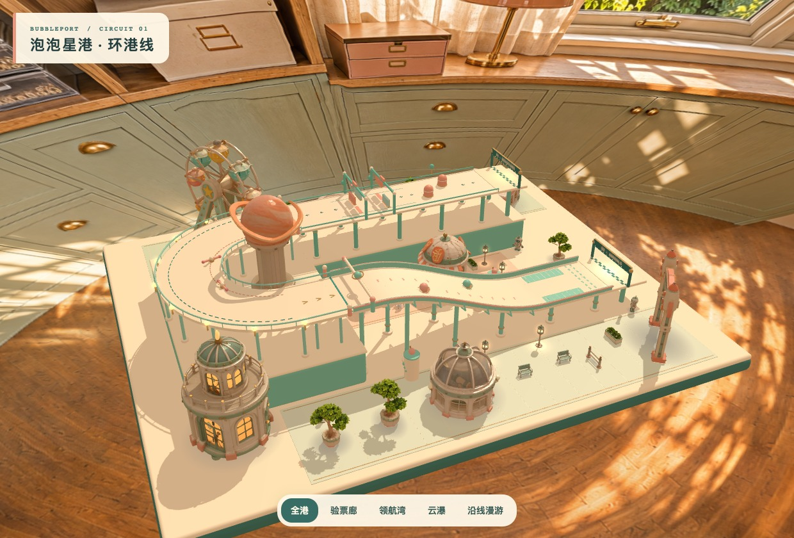

# 泡泡星港 · 环港线

**版本状态：开发阶段场景展示 demo 和中间产物，不是最终游戏。** 本目录及其 `overview.jpg` 仅保留历史过程，不能作为已部署泡泡星港的游戏画面或最终美术基准。当前版本请查看[线上游戏](https://actionl.ink/bubbleport/)和[发布目录说明](../bubblecity-teddy-slide/README.md)。模型和材质可逐项审核复用，版本状态不等于素材被全部废弃。

在仓库根目录运行 `python3 -m http.server 8893 --bind 127.0.0.1`，打开[环港线场景](http://127.0.0.1:8893/bubbleport-circuit/)。拖动旋转、滚轮缩放；底部可选全港、三个分区和约 48 秒的沿线漫游。

从出发站穿过苏打验票廊，在土星地标旁完成 180° 回头弯，再沿云瀑滑梯下降 16 个单位到达终点。三段直接复用[设计台](../bubbleport-segment-designs/)的程序几何与机关动画，接口净宽均为 19.2。这里是可浏览的场景，未接入角色物理和比赛判定。

设施来自本地 16 件 Hi3D 原件（`.local/bubbleport-scenery/`）；[轻量化脚本](prepare.py)用 gltfpack 减面、Pillow 缩放贴图至最长边 1024（月牙观测塔为 2048，单独限制减面误差以保留栏杆和窗框），保存在 models/ 下。

关卡材质编辑器已迁入[泡泡星城 demo](../bubblecity-teddy-slide/README.md)。原环港线使用的 `studio-6k.jpg` 和 `studio-light-1k.hdr` 全景组合已废弃。当前场景与小熊试玩共用 `slide/workshop.js` 加载的六面工作室背景和环境反射。
