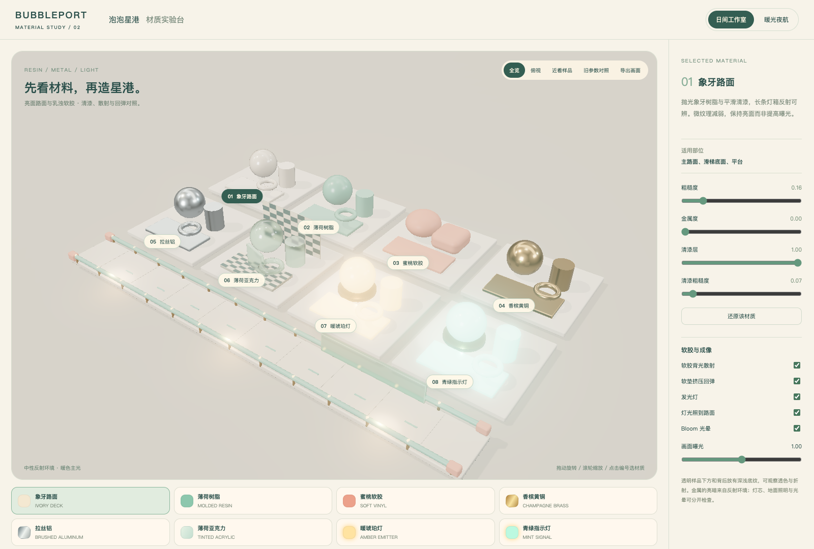

# 泡泡星港 · 材质实验台

[亮面路面与软胶的成熟材质参考](references/README.md)整理了 Plastic010、柔触塑料、玩具软乙烯及官方清漆/SSS示例，并区分当前样板与下一轮建议；已用于本轮V2样板；旧参数对照保留在页面中。

已归档[八种材质参数与28张PNG纹理](../assets/bubbleport-course-resources/materials/README.md)，可从[资源总览](../assets/bubbleport-course-resources/index.html)或[ZIP资源包](../assets/bubbleport-course-resources-v1.zip)取用。归档同时保存运行时参数与逐材质贴图的导入方式。

在球、圆柱、圆环、倒角平板和弯管上复现泡泡星港概念图中的材质方向。使用可复用的 Three.js PBR 材质与实际灯光，不调用 ImageGen，不需要新增模型。

在仓库根目录启动：

```sh
python3 -m http.server 8893 --bind 127.0.0.1
```

打开 [材质实验台](http://127.0.0.1:8893/bubbleport-material-lab/)。选择样品或底部色卡；拖动旋转，滚轮缩放，可切换全览、俯视或近看。右侧调整当前材质；前方赛道截面共用同一份材质，参数修改会同步显示。支持还原该材质和导出PNG。

| 材质 | 初始参数 | 主要表达 |
|---|---|---|
| 象牙路面 | roughness .16 / metalness 0 / clearcoat 1 | 弱化微凹凸、平滑清漆与长条反射，清漆粗糙度 .065 |
| 薄荷树脂 | .29 / 0 / .48 | 模塑壳体与较清晰的清漆反光 |
| 蜜桃软胶 | .39 / 0 / .025 | 柔和高光、背光散射近似；圆角软垫展示受压与回弹 |
| 香槟黄铜 | .26 / 1 / .08 | 暖色导体反射与细拉丝 |
| 拉丝铝 | .34 / 1 / 0 | 中性金属反射与粗糙度纹理 |
| 薄荷亚克力 | roughness .09 / transmission .94 / IOR 1.46 | 透色、折射、厚度吸收、清漆反光；深浅底纹用于读透射 |
| 暖琥珀灯 | emissive intensity 4 | 暖色自发光与邻近受光 |
| 青绿指示灯 | emissive intensity 3.2 | 与暖灯区分状态的青绿色发光 |

参数是视觉调试起点，不是对真实材料的测量值。金属的粗糙度还受微纹理图调制。布景、环境反射、几何倒角和曝光共同决定最终观感。

## 发光的三层表现

1. **灯芯自发光**：材质的 emissive，不依赖外部光照；开启它不等于自动照亮其他物体。
2. **灯光照到路面**：独立 PointLight 的直接照明，让相邻路面和金属接收到暖色/青色光。
3. **Bloom光晕**：HDR后处理提取高亮区域并扩散，阈值2.4，日间强度.12，夜间.24。关闭Bloom后自发光与地面照明仍保留。

日间/暖光夜航切换主光、补光、环境反射强度及布景底色；当前是两套美术预设，不能视作同一环境的测光对比。三个灯光开关可在同一环境下单独比较。标准球形几何的玻璃透射是屏幕空间近似，不提供离线光追、焦散或透明件之间的精确多次折射。

## 文件与复用

- `materials.mjs` 只作兼容转发；唯一主源码在 `../material-atlas/dist/original/bubbleport/materials.mjs`，导出 `materialSpecs` 与 `createBubbleportMaterials()`，包含八种材质和本地程序化微纹理。后续可直接用于赛道路面、护栏、机关壳体与灯罩。
- `lab.mjs` 实现样品、赛道截面、光照环境、Bloom与交互。
- Three.js r185 核心复用 `../bubbleport-demo/dist/vendor/`；本地所需的同版官方附加模块放在 `vendor/`，MIT许可保存在 `vendor/LICENSE-three`。环境反射由RoomEnvironment/PMREM在本地生成，没有外网纹理依赖。



[夜航总览](review/night.png) · [亚克力近看](review/acrylic-detail.png) · [黄铜近看](review/brass-detail.png) · [灯光近看](review/amber-detail.png)。

## 验证

已用本机Chrome检查八种材质构建、日夜切换、单材质参数修改与还原、三种视角、发光/受光/Bloom独立开关、PNG导出及390px手机布局；无脚本或资源加载错误。结果在 `review/validation.json`，截图在 `review/`。复现命令：`node bubbleport-material-lab/review/verify.cjs`，需先启动上面的服务；脚本依赖邻近 `rea/node_modules/playwright-core` 和本机Chrome。

当前是材质与灯光样板，尚未替换现有赛道试玩的材质，也未进行目标设备帧率预算或全关卡性能验收。

## V2更新与统一目录

原创源码、28张贴图、预设及参考集中在 `material-atlas/dist/original/bubbleport/`，Lost Marbles 的研究源码仍在材质标本室的 `dist/lm/` 分类；本轮没有移动或改写另一个agent维护的其他分类。原赛段资源库的 `materials/` 已改为指向原创目录的兼容软链接；ZIP打包时会展开为实际文件。

“旧参数对照”在相同几何体、光照和曝光下切换V1/V2表面参数；这是材质对照，不是两个完整历史场景的对照。软胶的散射与回弹开关相互独立。当前散射是单层实时背光近似，没有测量厚度和多次体积散射；软垫回弹是展示动画，不是碰撞软体物理。
