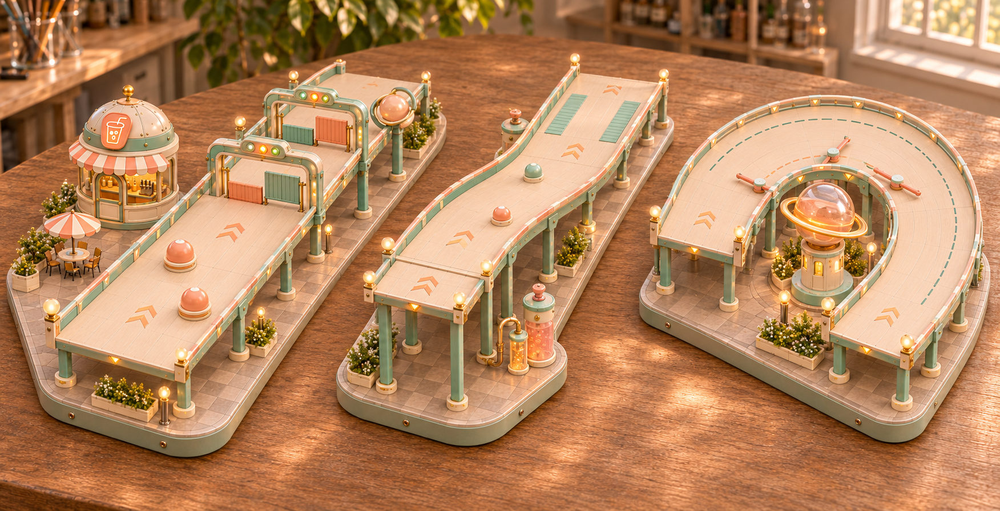
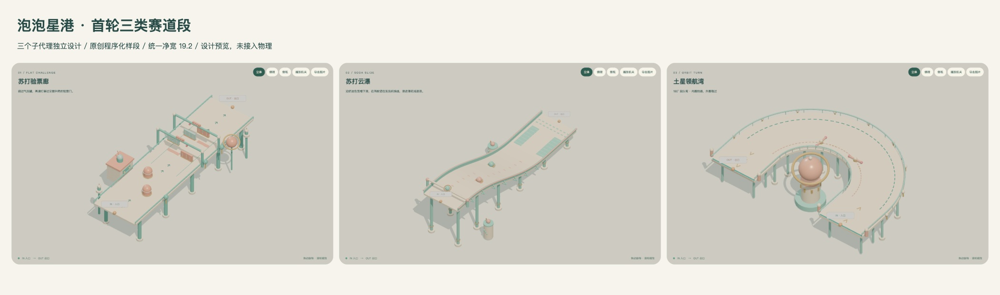

# 泡泡星港 · 首轮赛道段设计

六段俯视采用图、三段结构图、效果参考与材质纹理现已统一保存到[赛段与材质资源库](../assets/bubbleport-course-resources/README.md)。[打开总览](../assets/bubbleport-course-resources/index.html) · [下载ZIP](../assets/bubbleport-course-resources-v1.zip)。原目录中的迭代稿与交互预览继续保留。

三个子代理分别设计平地关卡、下坡滑梯和180°回头弯，主代理统一预览工具、配色、角色比例和路面接口。参考本仓库 Lost Marbles 模块图录的关卡结构；模型为原创程序几何，不使用原游戏生成器、网格或贴图。

| 类型 | 样段 | 主要玩法 | 尺寸 | 设计说明 |
|---|---|---|---|---|
| 平地直线 | 苏打验票廊 | 错位绕罐 → 两排交替升降验票门；侧廊可安全绕行 | 净宽19.2，长72，落差0 | [完整说明](designs/flat.md) |
| 滑滑梯 | 苏打云瀑 | 连续下滑 → 两枚错位浮标 → 选择减速带 | 净宽19.2，长88，落差16，最大纵坡约24.2° | [完整说明](designs/slide.md) |
| 转弯 | 土星领航湾 | 内线短但需避拨片；外线长且没有机关 | 净宽19.2，中心半径24，180°，中心线长103.4 | [完整说明](designs/turn.md) |

统一以直径1.3的角色为设计基准，薄荷绿、象牙白、蜜桃色树脂外观，配独立港口支柱、苏打设施和土星导航装置。尺寸为设计单位，不解释为现实米数。路面净宽指两侧边界间距，机关会局部占用空间；实际碰撞宽度需要接入游戏后标定。

## 星港横移门

[打开三排移门赛段](http://127.0.0.1:8893/bubbleport-segment-designs/#doors) · [近看](review/sliding-gates-detail.png) · [俯视](review/sliding-gates-top.png)。一排为一个[独立白模](../assets/model-library/commonplay/bubbleport/obstacles/runtime/starport-sliding-gate.glb)，包含四个门壳、三个伸缩门板组和四组信号灯。每洞净宽 4.8，四片门叶逐层收入同一侧壳体。评审台读取 GLB 的材质槽并绑定项目材质，可播放预警和换洞过程。

## 六段赛道俯视设计

后续设计集中在路线与障碍关卡，参考小熊滑滑梯的模块节奏，提供六张独立的泡泡星港俯视图：双摆锤、三门洞移门、柱子群、直滑梯、180°回旋滑梯、星浪踏板。[打开图片索引与设计说明](topdown-v1/README.md)。组件制作优先复用已有资产。

## ImageGen效果与资产缺项

结构复核后，使用**内置ImageGen**结合原始泡泡星港风格图、三段结构总览和既有汽水店参考生成了一张整体效果图。它表达材质和氛围，尺寸与机关布局仍以程序样段为准。



[模型库盘点与精做优先级](art-direction/asset-gaps.zh-CN.md)区分已有3D、仅有参考图和全新缺项。首批建议精做验票门、土星地标、汽水店；旋转拨片作为下一优先级。路面、护栏、支柱和普通浮标继续参数化。现有16套设施参考不等于16个可用3D模型。

[完整提示词](art-direction/imagegen-prompt.txt) · [生成来源](art-direction/generation-v1.json) · [结构复核](review/structure-audit.json) · [机器可读模型盘点](art-direction/library-audit.json)。当前未新增高精度建模任务。

## 打开3D评审台

在**仓库根目录**运行：

```sh
python3 -m http.server 8893 --bind 127.0.0.1
```

打开 [本地评审台](http://127.0.0.1:8893/bubbleport-segment-designs/)。可切换三个样段、拖动旋转、滚轮缩放、切换俯视/侧视、播放机关和导出当前模型图片。Three.js 复用 `bubbleport-demo/dist/vendor/`，因此请从仓库根目录提供服务；其 MIT 许可证在该目录保留。



[直道](review/flat.png) · [滑梯](review/slide.png) · [转弯](review/turn.png)。`review/` 也包含每段俯视、侧视和手机截图。

## 交付边界与检查

这是设计评审原型，未改动现有试玩。机关动画只表达设计周期；没有角色操控、碰撞、减速带物理或通关判定。文档中的目标时间、受撞效果与恢复代价均为后续实现要求，未宣称实测完成。

2026-11-08 已用本机 Chrome 检查三个模块构建、立体/俯视/侧视、机关播放切换、390px手机布局；未发现脚本异常、HTTP资源错误或横向溢出。记录见 [validation.json](review/validation.json)。截图复现工具为 `review/render.cjs`，依赖邻近 `rea/node_modules/playwright-core` 和本机 Chrome，运行前需启动上面的服务。

后续建议先将三段的路面、护栏和机关接入同源碰撞，再标定滑姿、坡底承接、弯道相机与多人拥堵。首轮暂不追加更多类型。
