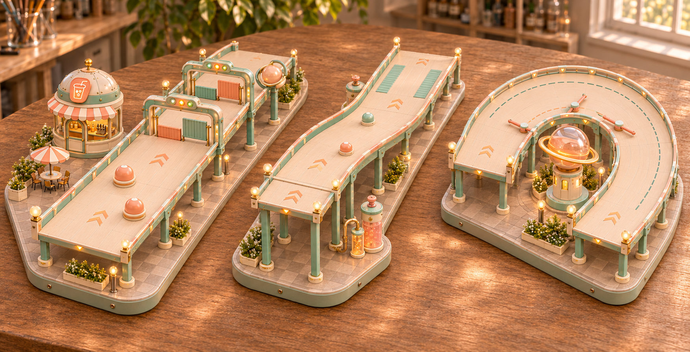

# 三段赛道的美术精做与模型缺项

2026-11-08。范围是本仓库、相关本地原模目录及可查询的近期 Hi3D MCP 任务记录；不把本次扫描解释为远端网站全部历史资产的完整盘点。以下“缺”表示没有找到对应可复用的本地 3D 资产，参考图和程序占位体不算成品模型。

## 结构与效果图

[效果图 v1](three-segments-effect-v1.png)由**内置 ImageGen**生成，输入为原始泡泡星港微缩乐园概念、三段程序结构总览和既有汽水店斜视参考。目标是保留直道、下坡、回头弯的布局，并恢复象牙树脂、薄荷边框、蜜桃亚克力、黄铜接头、暖窗灯和微缩园艺。完整提示词在 [imagegen-prompt.txt](imagegen-prompt.txt)。没有新增 Hi3D 建模任务。

效果图是美术方向，尺寸、碰撞和机关运动范围仍以程序样段与文档为准。图中栏板、接缝、花箱和灯光不应反向改变净宽；透明材质、灯光和纹理不需要全部变成高密度几何。正面遮挡和透视不能用于验收坡度。

结构检查见 [structure-audit.json](../review/structure-audit.json)：三段顶点数值有效、各自为连续单条路面、净宽参数19.2、出入口水平。直道长72；滑梯水平投影长88、沿坡中心线长约90.72、落差16、最大采样坡24.17°；弯道中心线长103.39。通过这些检查表示可进入美术评审，**不代表碰撞、减速、多人或通关已验证**。

## 当前模型库实际有什么

| 资产组 | 已有内容 | 对本轮的意义 |
|---|---|---|
| [16个星港设施](../../assets/bubbleport-model-references/README.md) | 16套四视图/独立视图，部分有动态状态设计；各目录均无GLB/FBX/Blend模型 | 是建模输入，不能当作已有3D。土星地标、汽水店、路灯、花箱、桌伞等已有视觉身份，应沿用 |
| [独立胶囊障碍](../../bubbleport-demo/dist/assets/obstacle-capsule.glb) | 已有高模原件与运行版；运行版12000三角面、471240字节 | 可复用为通用碰撞垫。与效果图的圆苏打罐不同，换成圆罐时只需简单重建壳体 |
| [土星锤头](../../bubbleport-demo/dist/assets/mallet-head.glb) | 已有高模原件与运行版；运行版11999三角面、501808字节 | 后续摆锤可复用；它是锤头，不是本轮的土星灯塔或旋转拨片 |
| [17个角色原模](../../assets/toy-town-personas/README.md) | 本地找到17个独立角色original.glb，其中7个是星港机器人；原有10角色已有游戏版流程 | 装饰机器人可优先选现有机器人。角色模型存在不等于已具备场景NPC绑定和低模；无需另造同岗位机器人 |
| [3段Hi3D整段原模](../../docs/track-redesign-validation.zh-CN.md) | 错位障碍、摆锤、回环原模；均为约190万面单网格且无动画 | 已有但未批准直接进入游戏；不能提取为本轮准确滑槽、门组件或弯道碰撞，不建议重复生成整段 |
| 当前三个程序样段 | 完整路面、护栏、支架、机关代理及部分动画 | 尺寸和布局依据；粗几何外观不算高精度成品资产 |

机器可读盘点见 [library-audit.json](library-audit.json)。其他题材的木制滑槽、风港场景没有计入星港设施成品库。

## 建议精做的四个资产包

这里的“精做”指近景轮廓、材质、装配、活动部件和烘焙质量；不要求将高模直接放进游戏。P0先做，P1可在第一轮试玩后补。

| 优先级 / 资产包 | 当前缺项与复用依据 | 精做重点 | 必须独立的部分 | 作用 |
|---|---|---|---|---|
| **P0 · 升降验票门套件** | 全新缺项；已有14号火箭门架只是装饰参考，不能充当带双升降通道的机关 | 圆角导轨外壳、伸缩/滑动结构、灯罩、锁扣、底部软包；两种颜色共用结构 | 静态框架、左门板、右门板、左右信号灯；门板轴心和升降方向固定 | 直道的核心玩法与视觉识别；一套实例化两排，不分别生成两个整门 |
| **P0 · 土星领航地标** | 已有01号四视图与动态设定，缺3D；锤头不是同件 | 透色球壳、独立轨道环、内部灯芯、带检修门和窗的底座 | 底座、球壳、轨道环、灯芯；透明与发光分材质 | 回头弯的视觉锚点。按01号身份制作，依内庭尺寸适配；先不额外造第二座“灯塔” |
| **P0 · 汽水店** | 已有03号四视图，缺3D；程序方盒亭需替换 | 穹顶分片、双色遮篷、拱形窗框、汽水图标、少量室内剪影和暖灯 | 建筑外壳、玻璃、招牌、可选门扇；内部可用浅层陈设 | 一件高辨识度建筑即可显著恢复泡泡星港风格；放在直道外侧 |
| **P1 · 旋转拨片组件** | 全新缺项；胶囊和锤头均不具备该装配关系 | 紧凑轴盖、软包杆端、黄铜轴套、固定底座；控制外轮廓 | 底座、竖轴、对称双臂转子；两组实例共用一件资产 | 回头弯的玩法部件。可先用参数几何；精做不允许增加现有3.18半径的运动包络 |

### 资产制作约束

- 验票门按现有宽5.2、高2.8的门板与升程4.8适配；不要让造型花边侵入两侧3.8宽设计绕行廊。每排门的有效外框开口和灯色要可读，碰撞体独立。
- 土星地标在现有内庭包围范围内缩放，底座不能顶到弯道内缘；环、灯光和透明球不参与通行碰撞。
- 汽水店与03号独立视图保持身份一致，圆顶亭不能再被泛化成普通方盒。临路店面、招牌和遮篷不得伸入赛道路面。
- 旋转拨片保留每4秒一圈的预览周期；高模导出时不能把底座与转子焊成一个不可拆的整体。正式碰撞仍由简单杆体和端球表达。
- 后续若使用生成式建模，每次一个可拆资产；先检查背面、薄壁、轴心、法线和材料槽，再减面、烘焙与导出。不要把效果图整张当作单物体建模输入。
- 第一版游戏模型可暂以每件约5k–15k三角面、1K–2K贴图为预算起点，按屏幕占比和实机表现调整。这是建议预算，未进行目标设备性能验收。高模仅作制作源文件。

## 可以继续程序化制作的部分

| 部分 | 为什么无需先补高模 | 建议处理 |
|---|---|---|
| 直路、余弦滑槽、180°弯道 | 净宽、曲率和连续性比纹理细节更关键 | 同一参数源生成可见网格与碰撞；仅给边缘倒角和材质分区 |
| 连续护栏、滑梯护壁和包边 | 都沿中心线扫掠；单个手雕模型难适配不同长度 | 曲线扫掠、实例化立柱和接头；不要让装饰接头缩窄通道 |
| 桥墩、脚座、横梁、铆钉 | 重复硬表面体；已有程序尺寸可直接升级 | 统一端帽和少量倒角；用实例化控制重复件开销 |
| 两只苏打罐与两枚浮标 | 球/回转体轮廓简单，瓶盖和色环可由简单几何表达 | 程序几何加烘焙或贴图；通用软垫可直接复用已有胶囊 |
| 外侧苏打储罐 | 是简单圆柱、球冠与弯管；对玩法无决定影响 | 中精度手工或程序装配即可，暂不列高模优先项 |
| 路面箭头、减速纹、标线、接缝 | 属于表面图形与材质 | 贴花或纹理，避免用凸起几何制造意外碰撞 |

## 景观缺项：已有参考，可择需转3D

效果图里的**10号路灯、11号花箱、12号遮阳伞桌、13号咖啡椅**都有现成参考图，但没有对应本地3D。它们是P1/P2景观制作项，先各做一个可复用中精度模块即可，不与核心机关同一优先级。16号广场围栏也是参考而非赛道精确护栏，不能直接替代曲线边界。

本轮不需要新增摩天轮、观测塔、穹顶馆、终点站房、弧形商铺、小树或第八个机器人。它们可以留待完整关卡环境；避免为了贴近效果图一次补完所有16件设施。

## 效果图人工复核

- 已保留三种不同路型、两排验票门、两枚浮标、两组拨片，以及店铺在路外、土星在内庭的布置。
- 材质和灯光已向原参考图靠拢；附加了灯、花箱、桌伞与接头细节，均属于美术意向。
- 直道闸门的侧廊、滑梯坡度与弯道半径无法从这张透视效果图精确验收；使用程序布局锁定。图中门板姿态是单一瞬间，不用于推导时序。
- 下一步先精做验票门、土星地标和汽水店；拨片可沿用代理体完成玩法验证后替换。当前只交付效果图与资产计划，没有开始高精度建模。
