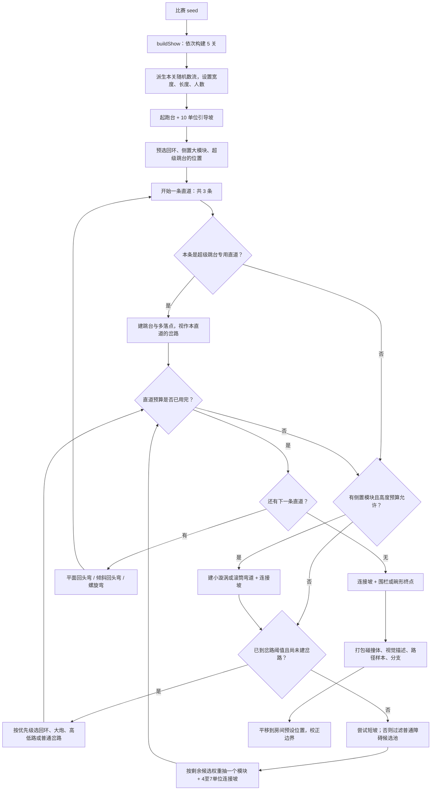

# Lost Marbles 赛道随机生成机制

目标版本：2026-11-08 获取的公开交付脚本。这里分析常规随机比赛；Course Builder 的指定配方是另一条生成分支。

本文仅供学习研究，不作商业用途。相关权利归各自权利人所有，如涉及版权问题，可通过 [GitHub Issues](https://github.com/SijiaRong/commonplay/issues) 联系删除。原始脚本及分析用结构数据保留在本地；研究渲染图已纳入报告。

完整场景与机关外观可对照 [REA 逆向分析中的五关高清图](lost-marbles-rea-analysis.zh-CN.md#full-course-gallery)：包含五关同场全景，以及每关的完整路线俯视、斜向全景和三个机关特写。图片对应固定种子 `20261108`，用于结构分析。

## 1. 整体流程

核心方法是**预设结构 + 有约束的模块抽取 + 参数扰动**。模块形状由程序生成，并非下载一些 GLB 后任意摆放。



上图省略局部尺寸计算和失败后继续填充的细节；直道长度是装配预算，部分短模块及连接坡可使实际长度略超预算，并非精确裁剪后的长度。

源码：[buildStage](https://meticulai.com/games/lost-marbles/shared/course.js)、[mulberry32 随机数器](https://meticulai.com/games/lost-marbles/shared/rng.js)。本地对应 `course.js:2641`、`rng.js:3`。

## 2. 固定的骨架

| 关卡 | 起跑人数 | 宽度 | 单条直道目标长度 | 普通基础坡度 | 终点 |
|---|---:|---:|---:|---:|---|
| 1 | 50 | 18 | 96 | 0.070 | 围栏 |
| 2 | 40 | 17 | 100，最后一条 70 | 0.076 | 碗形 |
| 3 | 30 | 16 | 104 | 0.082 | 围栏 |
| 4 | 20 | 15 | 108 | 0.088 | 围栏 |
| 5 | 10 | 14 | 112，最后一条 82 | 0.094 | 碗形 |

每关固定三条直道，用两个 180° 转弯串成折返结构。第一转向以 50% 概率决定，后续交替。每条常规直道安排一个主岔路；超级跳台的多落点替代常规岔路。蹦床模块内部还会登记自己的落点分支，因此输出的 `forks` 总数可能超过三个。第 2、5 关为碗形终点，因此最后一条直道减去 30 单位，给终点腾位置。普通坡度不等于整关恒定坡度，各模块还会引入额外落差、起伏和飞跃。

这保证了每场比赛虽不同，但仍拥有相同的基本节奏：起跑 → 障碍与路线选择 → 折返 → 障碍与路线选择 → 折返 → 终点。

## 3. seed 如何决定结果

使用 mulberry32：从一个 32 位状态连续产生 0–1 的伪随机数。其上封装区间取数、整数、概率判断、洗牌和加权选择。

常规关卡随机数种子：`seed XOR imul(index + 1, 0x9e3779b1)`，转成无符号 32 位。`index` 从 0 开始，因此五关即使共享比赛 seed，也会有不同序列。

侧置模块和超级跳台/大炮的决策另外派生随机数流，减少这些选择与普通模块抽取的耦合。模块实际搭建仍可能消耗关卡随机数，因此不能认为改动任意一种模块后，其余全部布局必定保持不变。

同一版本生成器、同一参数及同一 seed 才能重建相同赛道；修改代码或参数会改变结果。本地已验证 seed `20261108` 重复生成一致，换成 `20261109` 后不同。

## 4. 先安排大模块

### 回环

每关先以概率选择是否预留一条回环直道；命中后在三条直道中随机选一个。概率依次为 25%、70%、70%、75%、85%。回环岔路始终为两路：`loop` 加一条平缓备选，后者从 clear、pegs、stairs、bumpers、tunnel 中选。左右顺序会洗牌。

### 侧置模块

`sidePlan` 安排小漩涡 whirlpool 和滚筒弯道 drum。它们突出赛道外侧，因此常规情况下只能放在第一或最后一条直道的开阔侧；碗形终点关只使用第一条。每类每关最多安排一次，且仍需通过高度预算检查。

小漩涡五关的安排尝试概率为 30%、45%、40%、40%、50%；滚筒为 25%、30%、30%、35%、35%。模块顺序和槽位会洗牌，槽位不足或高度不够都可能无法出现，所以这些数值不是最终出现率。

### 超级跳台

每关尝试概率为 35%、50%、50%、50%、55%，只从合格直道中选一条：排除回环、侧置大模块、第一关的第一条直道，以及碗形关的最后一条直道。如果没有候选，本关不生成。

第一关使用较温和的 `MEGA_GENTLE` 参数，后续使用 `MEGA`。超级跳台的落点本身就是路线选择，所以本直道不再增加普通岔路。

## 5. 每条直道内部怎样拼

岔路目标位置先随机取直道预算的 25%–55%。生成器不断累加 `used`；到达阈值时，在下一次模块装配决策处插入岔路，因此实际位置不一定精确等于阈值。

填充普通模块前，还有 25% 的短连接坡尝试；如果上一块已经是 ramp，就不能连续再选这类坡。坡长 8–14 单位，其中 35% 的概率设置加速。这些同样是条件分支概率，不能直接解释成全赛道有 25% 的长度是坡道。

普通候选池先按下列条件过滤：

- 到达该模块的最早关卡；
- 不与上一模块同名；
- 陡降 plunge 每关最多一次，且高度预算足够；
- 陀螺 spintop 不紧跟岔路或超级跳台；
- 长模块要给剩余直道及尚未生成的岔路预留空间；
- 某些腾空模块不紧接螺旋转弯；
- 直道刚开始的前 10 单位，cliff、cascade、bigAir 的有效权重设为 0。

再对候选进行加权抽样：`P(模块) = 当前有效权重 / 当前候选总权重`。权重不是百分比，会随关卡、上一模块和剩余空间变化。抽中后，模块自身还会随机长度、数量、障碍位置等参数；随后通常添加 4–7 单位坡道，制造喘息空间。

高度预算示例：当前已消耗落差 + 特殊模块落差估计 + 剩余长度×0.13 + 剩余转弯×5 + 终点预留落差，必须不超过本关可用高度。它是构建时的保守估算，并非先用物理机器人跑完再判定可通关。

## 6. 普通模块池：22 类

| 模块 ID | 中文说明 | 最早关卡 | 原始权重 |
|---|---|---:|---:|
| pegs | 钉柱阵 | 1 | 2 |
| spinners | 旋转拨杆 | 1 | 2 |
| bumps | 小凸块路 | 1 | 1.2 |
| funnel | 收口漏斗 | 1 | 1.2 |
| bumperField | 弹性碰撞阵 | 1 | 1.4 |
| rollers | 横向滚筒 | 2 | 1.4 |
| hills | 波浪坡 | 1 | 1.2 |
| hammers | 摆锤 | 2 | 2 |
| gates | 活动闸门 | 2 | 1.4 |
| sweeper | 大扫杆 | 3 | 1.4 |
| trapFloor | 陷阱地板 | 3 | 1.4 |
| cliff | 小落差 | 1 | 1.2 |
| bigAir | 腾空跳台 | 2 | 1.4 |
| cascade | 阶梯瀑布 | 1 | 1.1 |
| seesaws | 跷跷板 | 2 | 1.4 |
| keys | 上下浮动钢琴键 | 1 | 1.4 |
| halfpipe | 半管道 | 1 | 4.2 |
| hoopJump | 穿环跳 | 1 | 3 |
| hopscotch | 跳格子 | 2 | 3.2 |
| trampolines | 蹦床 | 2 | 3.4 |
| plunge | 陡降滑槽 | 1 | 2.6 |
| spintop | 旋转陀螺 | 1 | 1.6 |

这些名称对应生成函数及组合结构，不是固定尺寸的现成模型。

已将这 22 类普通路段连同 3 类特殊路段、4 类岔路结构、3 类转弯和 2 类终点整理为[34 类完整路段模块图录](lost-marbles-module-atlas.zh-CN.md)，每类一张 4096 × 3072 大图，同图展示完整立体路段、入口出口俯视和另一侧机关结构。

## 7. 岔路怎样搭配

选择有明确优先顺序，不是把全部分支放进一个池等概率抽取：

1. 本直道被预留给回环：固定选择回环 + 平缓备用路。
2. 否则尝试大炮：每关最多一次，排除碗形关的末条短直道；每个合格的岔路尝试概率依次为 20%、35%、35%、35%、30%。
3. 否则以 38% 概率尝试高低路；HIGH 位于外侧，LOW 留在安全低处。宽度至少 16 时，还能加 pegs、boost 或 spinner 第三路。
4. 否则从设计好的普通组合表选择，再洗牌左右顺序。

普通三路组合包含：stairs/beam/spinner、pegs/jump/hammer、clear/trap/bumpers、tunnel/beam/stairs、bumpers/boost/pegs、spinner/jump/clear、hammer/trap/tunnel。

双路组合包含：beam/stairs、jump/pegs、trap/clear、boost/bumpers、hammer/tunnel。宽度至少 15 且满足阶段规则才生成三路；最后一关宽度 14，普通岔路只生成双路。

分支共用起点与终点的逻辑距离。几何构建会分配各路宽度，添加分隔墙、圆头护柱和入口标牌，再调用每种分支的生成逻辑。它们在岔路末端汇合。机器人的选路还会参考各分支的 speed/risk 元数据；这些数值不是玩家每条路线实测的速度或死亡率。

## 8. 转弯、终点与交付数据

两条直道之间先尝试螺旋弯：五关概率为 0%、30%、35%、35%、50%，但每关最多一次。没有选螺旋弯时，再以 45% 概率选倾斜弯，否则选平面回头弯。这是每个合格连接处的条件概率，不是整关出现率。

最后添加 8 单位连接坡，接围栏或碗形终点。生成器打包三份相互对应的数据：

- `colliders`：物理碰撞体；
- `visuals`：供 Three.js 构建显示网格的描述；
- `path/forks`：供机器人、排名、重生和路线选择使用的路径与分支。

路径按约 1.5 单位间隔采样，整理成 TypedArray 和检索桶。`buildShow` 最后把五关平移到房间的预设位置，并拉回越过房间边界的部分。

因此“几何可连接、预算可容纳”主要由模块设计及装配约束保证。这段生成链没有做逐张地图完整仿真验收；不能声称所有种子都经过通关求解。

## 9. 一个真实 seed 的模块顺序

对 seed `20261108` 的第一关，源码实际生成：

```text
起跑台与引导坡
  → drum 滚筒弯道
  → 岔路 [bumpers / trap / clear]
  → turn 平面回头弯
  → halfpipe 半管道
  → 岔路 [stairs / spinner / beam]
  → spinners 旋转拨杆
  → turn 平面回头弯
  → spinners 旋转拨杆
  → cliff 小落差
  → 岔路 [beam / tunnel / stairs]
  → bumps 凸块路
  → 围栏终点
```

省略了连接坡和普通加速坡，这些坡未全部记入 `pieces`。不是每次第一关都会出现这套排列。

聊天中的配套图表使用三个 seed、每个五关的实际路径数据，以及 34 类模块/结构的碰撞几何示意。34 类包括普通模块、特殊模块、岔路示例、转弯和终点，不等于普通随机池有 34 个条目。曲面采用低分段展示，未包含原游戏材质，运动障碍只显示初始姿态。交互图表和提取的几何数据仅保留在本地；GitHub 版现已补充[34 类带原版材质的独立模块大图](lost-marbles-module-atlas.zh-CN.md)，与本文的流程图、参数表、模块表和文字示例配套。

本地提取脚本位于 `.local/lost-marbles/course-explainer/extract.mjs`：在内存中给已获取模块追加分析导出，调用原生成函数，不修改原始交付脚本。
