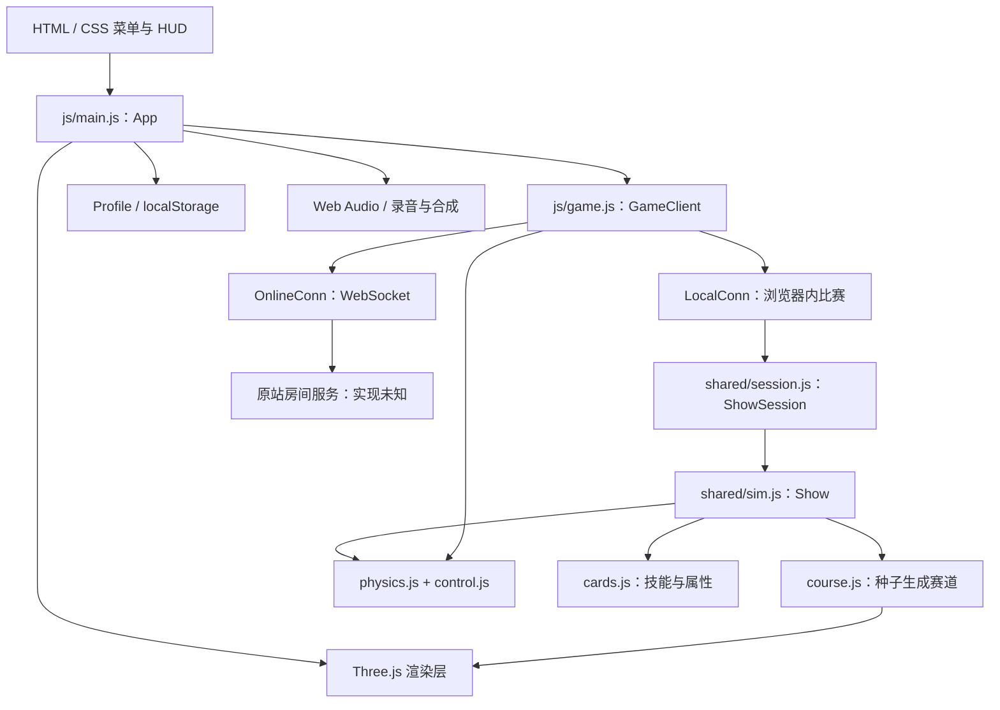

# Lost Marbles：REA 逆向分析

分析日期：2026-11-08，Asia/Shanghai。目标：[Lost Marbles](https://meticulai.com/games/lost-marbles/)。

> 本文仅供学习、研究和技术交流使用，不作商业用途。相关游戏、商标、源码及素材的权利归各自权利人所有。本文不授予第三方内容的使用许可，也不代表与原作者存在关联或获得其授权。如认为本文涉及版权或其他权利问题，请随时通过 [GitHub Issues](https://github.com/SijiaRong/commonplay/issues) 联系我们，我们将及时核实并删除相关内容。公开仓库仅包含分析文字，不包含下载的第三方游戏源码、素材和大型证据包；文中 `.local/` 链接仅在采集者本机可用。

结论：核心是原生 JavaScript ES Modules + Three.js r186 + 自研弹珠物理和比赛模拟。赛道及弹珠几何体主要由代码生成，画面结合摄影全景、扫描木纹、自定义玻璃着色器和移轴后处理。单机与联机复用共享模拟层。已经通过 REA 进行静态分析、物理/材质模块追踪和真实 Chrome 场景采集；这是一份实现分析与本地证据集，不是已经复刻完成的游戏。

## 1. 方法、证据与边界

采用用户本机 `/Users/cyberlingke/software/rea` 的 `reverse-engineer-anything` 技能和 REA 6.8.0 CLI。没有修改 MCP 注册或安装其他分析引擎。

1. 从公开 HTML、CSS、入口脚本及其静态 import 递归获取 45 个文件，共 3,050,684 字节。逐文件记录 URL、字节数、SHA-256 和获取错误；这不是原作者的完整源码仓库。
2. REA 选择分析 31 个应用 JavaScript 文件及 HTML；第三方库保留在文件清单中，未展开语义分析。31 个 JavaScript 均解析成功，无解析失败。
3. 生成 364 个应用图节点、680 条边，包括 366 条 imports 关系。283 个 `javascript-module` 节点包含 REA 的模块、导出等不同表示，不能解释为 283 个源码文件。
4. 对 `shared/physics.js` 和 `js/render/marbles.js` 分别运行 `trace-application-feature`，各保留 22 条追踪路径。
5. REA 启动独立临时 Chrome，执行菜单就绪 → 点击 Solo → 首次帮助 → 关闭帮助 → 等待 30 秒，采集截图、可访问性、最终 DOM、网络和错误事件。浏览器由 REA 清理，结果为 `terminated-owned-process`。
6. 在 Node.js 中运行已获取的共享逻辑，验证赛道种子、50 球模拟和协议编解码。该部分为额外行为探针，不是 REA 静态图推断。

**证据层级：** 下文标注的源码结论来自交付脚本；运行结果来自浏览器采集或本地探针；架构图和实现建议是基于这些证据的整理。

**局限：** REA 报告 application/semantic coverage 为 partial：12 个相关文件未选择分析，HTML 的一段内联脚本未分析，`shared/course.js` 和 `shared/sim.js` 的语义投影达到父进程结果预算，保留了静态及模块事实。不能把图中缺少某项当成该功能不存在。这两个模块另外经过人工源码检查和本地执行验证。

本机 Node 为 25.4.0，不在该 REA checkout 声明的版本范围内。本次以现有运行时完成构建和下列命令，未升级 Node；成功结果不代表整个 REA 工具集都经过兼容性验证。

没有读取原站私有服务端文件、测试多人房间或恢复服务端部署。没有下载完整媒体库，因此本地 public 目录不是可直接离线运行的游戏发行包。

## 2. 实际架构



图为源码关系整理，不表示本次观察过所有分支运行。

| 模块 | 实现职责 | 关键符号 |
|---|---|---|
| `js/main.js` | 启动、模式切换、菜单、画质、昼夜、奖励、房间 UI | `App.boot`、`startSolo`、`beginGame` |
| `js/game.js` | 比赛客户端、预测校正、镜头、HUD、渲染状态 | `GameClient`、`reconcile`、`interpolate` |
| `js/net.js` | 将本地与网络比赛包装成相同消息接口 | `OnlineConn`、`LocalConn` |
| `shared/session.js` | 玩家输入队列、模拟推进、广播事件和快照 | `ShowSession` |
| `shared/sim.js` | 比赛状态机、排名、机器人、技能效果和淘汰 | `Show.step`、`simulate`、`think` |
| `shared/course.js` | 生成碰撞、视觉描述、路线、分支和终点 | `buildShow`、`buildStage` |
| `shared/physics.js` | 碰撞和运动积分 | `World`、`stepWorld`、`stepSingle` |
| `js/render/courseView.js` | 把视觉描述转换为 Three.js 网格 | `CourseView` |
| `js/render/marbles.js` | 实例化球体、自定义玻璃和内部花纹 | `MarbleView` |
| `js/render/scene.js` | 相机、灯光、离屏渲染和后处理 | `Scene3D` |

本地文件：[入口](../.local/lost-marbles/public/js/main.js)、[客户端](../.local/lost-marbles/public/js/game.js)、[共享模拟](../.local/lost-marbles/public/shared/sim.js)。

## 3. 赛道与 3D 资源如何产生

### 3.1 程序化赛道

`buildShow(seed)` 根据同一随机种子构建五段赛道。一个 stage 同时输出：

- `colliders`：物理碰撞体；
- `visuals`：积木、柱子、曲面、横幅等视觉描述；
- `path`：供排名、重生、机器人使用的路径数据；
- `forks`：分支及危险类型；
- `grid`：起跑位置；
- `finish`：终点触发区域。

关键是**物理与显示共用一份生成结果**，无需为每段赛道手工制作模型和碰撞体。客户端与服务端可以各自由种子构建同一场地，不必持续传输整张地图。

本地种子 `20261108` 验证：连续两次 `buildShow` 序列化哈希一致，更换种子后不同。五个 stage 的碰撞体数量为 209、268、243、222、260；视觉描述数量为 750、900、837、801、857。它们不是实际 draw call 数量。

### 3.2 几何体优化

`geometry.js` 用代码构建倒角箱体、圆柱、旋转曲面和螺旋曲面。`CourseView` 把静态网格按材质和 48 单位空间块合并，兼顾减少 draw calls 与视锥剔除；运动障碍按批次实例化，使用碰撞体的同一套姿态计算。

因此这些核心场景并没有一套可直接下载的 GLB/FBX 模型包。可以运行构建代码后导出几何，但普通模型格式不能完整带走自定义着色器、比赛逻辑和后处理。

参考：[赛道生成](../.local/lost-marbles/public/shared/course.js)、[网格生成](../.local/lost-marbles/public/js/render/geometry.js)、[赛道显示](../.local/lost-marbles/public/js/render/courseView.js)。

## 4. 画面为什么有真实玩具感

### 4.1 摄影背景与环境光

`env.js` 使用 HDR 环境图提供 image-based lighting，经 PMREM 预过滤后供材质采样；背景使用 JPG 全景及 `GroundedSkybox` 地面投影。房间中心存在 `ShadowMaterial` 阴影接收平面，将真实 3D 物体的影子叠到照片地板上。

源码将 Play Room 全景归于 Poly Haven 的 Empty Play Room，另有阁楼和壁炉配置。房间照片不是可任意走动的完整室内网格；投影适合这一类相机活动受限的场景，不能直接替代自由探索房间模型。

### 4.2 木头和油漆

`materials.js` 读取橡木/白蜡木的 diffuse、normal、roughness 贴图，再设置 `MeshPhysicalMaterial`。油漆通过 `onBeforeCompile` 调整木纹对颜色的影响，并使用 clearcoat 模拟漆层。

纯白模型可以加这类材质，但木纹映射仍需要合适的 UV 或其他纹理映射方案。只有白模并不会自动获得这个画面。

### 4.3 弹珠的特殊实现

`MarbleView` 使用普通球体：低画质横向 24 段，其他画质 40 段。主体用一个 `InstancedMesh` 绘制，实例属性传递每颗球的颜色、花纹、旋转与表面处理；阴影、焦散和夜间光池另有绘制，不能说整个弹珠系统总共只有一次 draw call。

在物理材质的 `onBeforeCompile` 中注入 GLSL：

1. 将视线折射进球体；
2. 转到球体自身旋转坐标系；
3. 沿视线步进采样程序化猫眼、旋涡、星云、气泡等花纹；
4. 累积颜色和透射，结合环境反射；
5. 读取上一帧渲染结果，近似表现透过弹珠看到的场景和倒像。

光线步进按低/中/高画质使用 6/9/12 步。这是实时近似效果，并非离线路径追踪。普通 GLB 玻璃材质不会自动重现球体内部图案和这套折射。

### 4.4 后处理链

`scene.js` 的流水线为：HDR 场景/深度 → GTAO 环境光遮蔽 → 自定义移轴景深 → Bloom → AgX 调色及白平衡、对比度、颗粒、暗角、色差。

| 预设 | 像素比上限 | 阴影贴图 | MSAA | GTAO | 景深 | Bloom |
|---|---|---|---|---|---|---|
| high | 1.5 | 4096 | 4 | 开 | 全分辨率 | 开 |
| medium | 1.25 | 2048 | 4 | 关 | 半分辨率 | 开 |
| low | 1 | 1024 | 0 | 关 | 半分辨率 | 关 |

还会根据帧耗时调整渲染分辨率，最低到预设分辨率的 65%。手机默认小尺寸资源；帧率策略可降到 30fps。以上是代码策略，本次没有测量手机帧率或 GPU 性能。

参考：[环境](../.local/lost-marbles/public/js/render/env.js)、[材质](../.local/lost-marbles/public/js/render/materials.js)、[弹珠](../.local/lost-marbles/public/js/render/marbles.js)、[后处理](../.local/lost-marbles/public/js/render/scene.js)。

## 5. 物理与操控

物理模块使用纯数字和数组实现，未在该核心调用链使用 Rapier、Ammo 或 Cannon。固定模拟频率为 60Hz，每 tick 拆成 4 个子步；重力参数 46，物理最大速度 52。

碰撞形状包含定向箱体、有限圆柱、旋转轮廓壳体和螺旋曲面。静态碰撞体通过 XZ 空间网格筛选，网格单元为 10；弹珠两两碰撞用 O(n²) 检查配合提前排除。50 球每子步最多 1,225 对，规模固定，因此没有上复杂通用物理引擎。

`control.js` 负责地面加速、空中控制、跳跃及技能输入。基础球半径 0.5、质量 1、控制顶速 17、加速度 25、跳跃初速度 10.5；控制顶速不等于所有物理速度的绝对上限。

视觉上的球体旋转是客户端根据运动更新的表现层；不能把它直接理解为一套完整通用刚体角动量模拟。

本地行为验证：50 个机器人推进 2,400 tick，即模拟 40 秒，状态经过 starter → intro → countdown → race；所有球的位置有限，无 NaN/Infinity。没有把这次短运行表述为完整五关通关验证。

## 6. 玩法、机器人与存档

比赛状态机：初始选卡 → 入场 → 倒数 → 竞速 → 淘汰 → 选卡，重复至最终赛与领奖台。常规规则是 50 → 40 → 30 → 20 → 10 → 冠军，个别卡牌会修改淘汰等规则。

`cards.js` 包含 45 张卡，分四种稀有度，类型有数值、被动、主动和经济。初始六选三，后续三选一；抽卡考虑玩家卡组、稀有度、比赛阶段和场内已持有情况。`computeStats` 将卡牌应用到基础属性后限幅。本地验证一级 Polished Glass 使基础顶速由 17 增到 18.02。

机器人是规则驱动：沿赛道路径选择前视点，结合当前速度调整前视距离；在分支处选择路线，针对环道、跳台和碗形终点使用专用逻辑，加入能力差异和反应延迟。该核心逻辑不需要大模型推理。

`Profile` 通过 `lostmarbles.profile.v1` 存 localStorage，保存贴纸、XP、等级、卡牌、外观、设置和统计。这能确认客户端本地进度，不能据此断言线上没有其他数据持久化。

音频用 Web Audio API：真实弹珠滚动、碰撞和落地采样随速度/接触状态改变音量与音高；房间混响及部分 UI/音乐由合成产生。电台列表来自 `assets/music/stations.json`。

## 7. 多人网络协议

以下来自客户端和共享会话源码，**本次没有连接多人房间验证**。

- WebSocket 地址由当前路径构造，为 `/games/lost-marbles/ws`，HTTPS 下使用 WSS；无需据此猜测具体服务端框架。
- 控制消息是 JSON，世界快照为 ArrayBuffer 二进制；当前协议版本 8。
- 共享模拟 60Hz，`ShowSession` 默认每 3 tick 发送一次，即 20Hz；本地模式可每 tick 回调。
- 每颗弹珠公共状态占 15 字节：ID、标志、传送计数、量化位置与速度。位置乘 40 后存 i16，速度乘 100 后存 i16。
- 额外携带自己的精确浮点状态、技能计时器、输入确认序号，用于预测校正。50 球数据包在本地探针中为 816 字节。
- 据此推导，20Hz 时单收件人的快照负载约 16,320 字节/秒，不含 WebSocket/TLS/TCP、JSON 事件和其他流量；不是实测线上带宽。
- 自己的球立即执行本地输入；收到快照后丢弃已确认输入、恢复服务端状态、重放未确认输入，再平滑消除显示误差。
- 其他球用位置和速度做三次 Hermite 插值，缺少后续快照时仅短时外推；传送计数变化时单独处理。
- 重连带房间码和座位 token，最多重试 6 次，延迟指数增长并封顶 6 秒。

单机的 `LocalConn` 直接在页内运行 `ShowSession`，通过相同消息接口喂给 `GameClient`。这解释了为什么不需要为单机再写一套玩法。

参考：[连接](../.local/lost-marbles/public/js/net.js)、[会话](../.local/lost-marbles/public/shared/session.js)、[协议](../.local/lost-marbles/public/shared/protocol.js)、[预测校正](../.local/lost-marbles/public/js/game.js)。

## 8. 真实浏览器观察

本次采集约 53.4 秒，共观察 79 次 HTTP 请求，79 次响应均为 200，无 request-failed、console 或 page-errors 事件被记录，事件丢弃数为 0。该范围覆盖一次白天单机启动，不代表所有功能无错误。

确认实际加载了 43 个脚本、5 个字体、7 张图片、HDR、音效和音乐等资源，并请求 `api/stats`。后台还预取了夜景资源，因此资源被请求不等于夜间比赛已经执行。没有观察到 `.glb/.gltf/.fbx/.obj` 模型请求；结合几何源码可确认本次核心场景使用程序生成。

最终截图显示第一关 HUD、50 球排名和程序化弹珠材质，玩家当时处于第 27 名。采集没有操作移动按键，也没有验证主动技能、赛道编辑器、夜场或完整通关。

截图：[菜单](../.local/lost-marbles/menu-ready.png)、[第一关比赛](../.local/lost-marbles/solo-running.png)。

## 9. 对本项目与 Hi3D 的启示

如果目标是半天内做双人原型，建议先实现固定短赛道、两个可操控球、简单碰撞和胜负结算，再添加材质。五关淘汰、45 张卡、50 球联机、复杂玻璃和完整收集系统不适合作为首版同时实现的范围。

| 内容 | 建议做法 | 原因 |
|---|---|---|
| 球体、积木、坡道、弯道 | 代码或简单建模 | 低面数、尺寸可控、碰撞容易匹配 |
| 玩具熊、摆件、特色障碍外观 | Hi3D 白模或带纹理模型 | 将生成额度用在复杂形状上 |
| 物理碰撞体 | 独立简单几何 | 不直接用 AI 高面数外观网格当碰撞 |
| 纯色塑料、金属、玻璃 | 引擎配置材质 | 白模即可承担形状 |
| 木纹、文字、复杂图案 | UV + 贴图或程序纹理 | 白模本身不包含图案映射 |
| 类似弹珠内部图案 | 自定义着色器 | 不是 Hi3D 白模或普通 GLB 材质自动附带 |
| 房间真实感 | HDR、匹配主光和阴影 | 通常比先生成整间高精度房间更省资源 |

这是工作量与实现路线建议，不是已经验证的双人原型或特定 Hi3D 模型质量承诺。

## 10. 本地交付与复查

完整证据与下载快照放在 `.local/lost-marbles/`，已 gitignore，不随项目 MIT 许可分发第三方游戏源码、资源及大型分析文件。游戏源码未确认授权，素材来源与授权应逐项保留；网页可读取不等于所有资源都可重新发布。

| 文件 | 用途 |
|---|---|
| `public/` | 45 个已获取公开文件，保留原目录和字节 |
| `manifest.json` | URL、时间、字节数和逐文件 SHA-256 |
| `rea-summary.json` | REA 静态分析摘要、覆盖范围和局限 |
| `rea-evidence-bundle.json` | 完整 REA 静态证据，约 119 MB |
| `trace-physics.json` / `trace-marbles.json` | 物理及弹珠模块功能追踪 |
| `browser-scenario.json` | 可复查的浏览器操作声明 |
| `browser-evidence-bundle.json` | 浏览器截图、DOM、网络事件等证据 |
| `runtime-resource-inventory.json` | 本次浏览器请求的逐项 URL、类型和响应状态 |
| `probe.mjs` / `probe-results.json` | 本地行为探针及结果 |
| `findings-summary.json` | 两类证据 ID、图统计、浏览器结果及追踪统计 |

静态父证据 ID：`ev_b18a28c0916130cee4bf2c188261d90efcba0d58d8e2144373f8118001ec8e4f`。

浏览器父证据 ID：`ev_696843c1b39843b4f80cb7efc55b7052be7cfa6b8a9ee05359a07e2b2a4a1095`。

首次静态分析请求误把 CSS 作为相关源选择，REA 拒绝后已移除该选择；完整 bundle 的内容不受该失败请求影响。功能追踪第一次因验证大型 bundle 的堆空间不足而失败，随后使用 `node --max-old-space-size=4096` 成功执行；保留的是成功结果。

后续可直接复查保存的证据，不必重新采集网络：

```sh
cd /Users/cyberlingke/software/commonplay
node .local/lost-marbles/probe.mjs
node --max-old-space-size=4096 /Users/cyberlingke/software/rea/scripts/rea.mjs \
  trace-application-feature .local/lost-marbles/trace-physics-input.json \
  --evidence-bundle .local/lost-marbles/rea-evidence-bundle.json --format json
```

这些命令验证已下载的交付版本，不代表未来线上版本仍保持相同内容。
