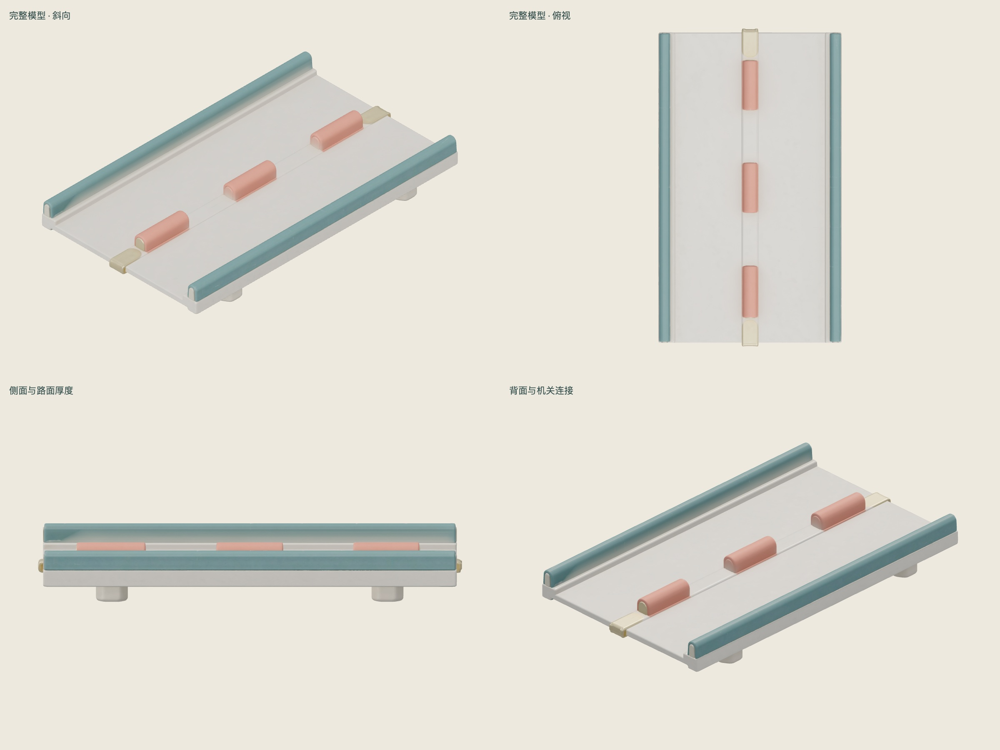
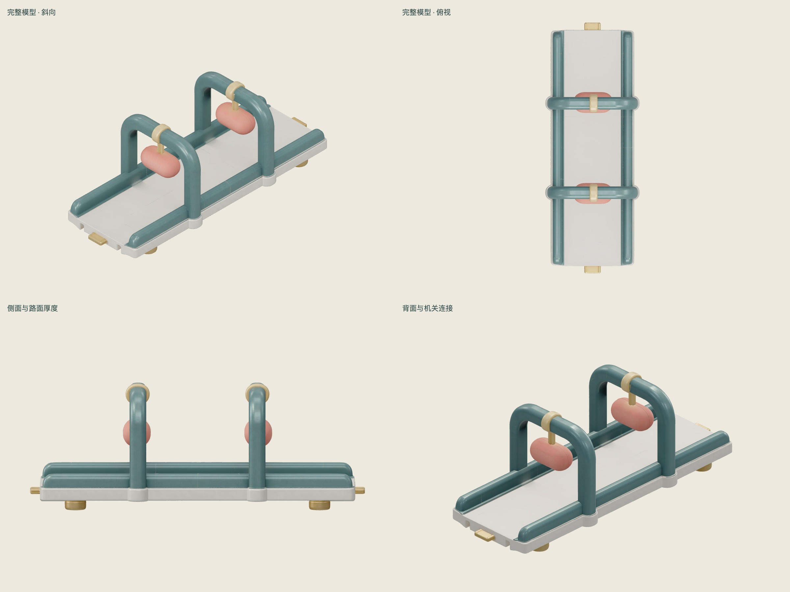
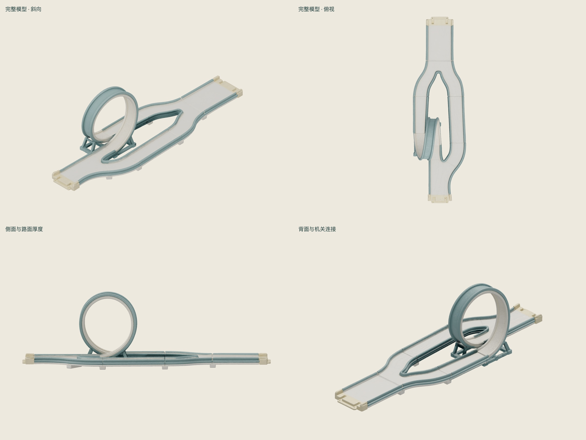

# 原创宽版路段：三类 Hi3D 首轮验证

**首轮已完成，实际消耗 153 积分。** 三个原始 GLB 均能通过基础格式检查并在 Three.js 中加载、生成四方向预览；三个均不批准直接接入运行时。结论是：Hi3D 可以快速提供统一外观，但本轮不能证明“整段交给 Hi3D 后即可保持玩法、准确加宽并直接使用”。不建议据此批量生成全部 34 类整段路段。

目标是普通错位障碍、双摆锤、回环与平缓备选岔路三个代表；通行宽度参考值从 16 增至 19.2（+20%）。外观由原创文字重新设计，采用米白模塑路面、深青连续护栏、淡黄接头、珊瑚软垫机关。未向服务上传原游戏截图、网格或贴图；这是设计流程记录，不构成版权结论。

## 实测汇总

| 样本 | 三角面 | 网格 / 动画 | 原始 GLB | 主要问题 |
|---|---:|---|---:|---|
| 宽版错位障碍路段 | 1,929,264 | 1 / 0 | 44.6 MiB | 路面和统一风格可辨认；但要求六块错位障碍，结果只有三块，且基本排在中线，未保留原定绕行节奏。 |
| 宽版摆锤路段 | 1,953,630 | 1 / 0 | 45.1 MiB | 两只摆锤和支架外观保留；生成结果没有可单独驱动的锤头、摆臂或转轴节点。 |
| 宽版回环与平缓备选岔路 | 1,973,000 | 1 / 0 | 45.6 MiB | 回环、平缓备选路和分合流轮廓存在；尚未验证回环曲面和分支碰撞是否能支撑实际运动。 |

三个模型均只有一个材质，均包含两张 8192 × 8192 贴图，没有显式顶点法线。模型没有单独可驱动的机关节点；一个网格并不代表内部每个部位都拓扑连通，但无法直接按“锤头/摆臂/转轴”等语义控制，仍需拆分或重建。高面数、8K 贴图需简化，缺失法线需补齐；不能直接用这样的外观网格作为物理碰撞体。

## 尺寸控制

提示词中的 19.2 是目标，不是生成器提供的尺寸保证。按参考图设定的总长把模型等比归一后，外沿总宽如下；实际可通行宽度只会更小。

| 样本 | 设定总长 | 归一后的外沿总宽 | 目标通行宽度 |
|---|---:|---:|---:|
| 宽版错位障碍路段 | 30 | 17.30 | 19.2 |
| 宽版摆锤路段 | 30 | 11.28 | 19.2 |
| 宽版回环与平缓备选岔路 | 50 | 14.26 | 19.2 |

以上是按长宽比计算的工程核对，不是模型自带真实单位。仅靠等比缩放无法同时固定目标长度和宽度；横向缩放后还需调整护栏、机关间距、分支和碰撞。没有进行路面平整度数值验收、回环动力学、完整比赛或通关测试，不能声称玩法已经保持不变。

## 三个实际生成结果

### 宽版错位障碍路段

[Hi3D 模型查看页](https://www.hi3d.ai/3d-model/56d562bdba534e439dad96f603998d4d) · [原始 GLB](../assets/track-redesign-validation/slalom-raw.glb) · [检查记录](../assets/track-redesign-validation/slalom-audit.json)

路面和统一风格可辨认；但要求六块错位障碍，结果只有三块，且基本排在中线，未保留原定绕行节奏。 需重新布置障碍并重做准确路面。

[原创建模参考图](../assets/track-redesign-validation/slalom-concept.png)。

### 宽版摆锤路段

[Hi3D 模型查看页](https://www.hi3d.ai/3d-model/29055da0d0cc4053bd5a14eda7c6fe75) · [原始 GLB](../assets/track-redesign-validation/hammers-raw.glb) · [检查记录](../assets/track-redesign-validation/hammers-audit.json)

两只摆锤和支架外观保留；生成结果没有可单独驱动的锤头、摆臂或转轴节点。 需拆分/重建机关、设置转轴和动画。

[原创建模参考图](../assets/track-redesign-validation/hammers-concept.png)。

### 宽版回环与平缓备选岔路

[Hi3D 模型查看页](https://www.hi3d.ai/3d-model/86a4eccf0d7b4082929cb986bda456b0) · [原始 GLB](../assets/track-redesign-validation/loop-raw.glb) · [检查记录](../assets/track-redesign-validation/loop-audit.json)

回环、平缓备选路和分合流轮廓存在；尚未验证回环曲面和分支碰撞是否能支撑实际运动。 需精确重建路面和碰撞，进行动力学验证。

[原创建模参考图](../assets/track-redesign-validation/loop-concept.png)。

## 后续制作方式

1. 用自编程序或精确建模制作路面、护栏、分支与回环，明确入口、出口和宽度参数，独立设置简单碰撞体。
2. 摆锤、滚筒、闸门等活动部分分别制作，保留独立节点和转轴；Hi3D 用于外观设计或单个可复用零件，避免把整条机关路段生成成一个整体。
3. 普通障碍的数量和错位位置由配置明确控制，避免将参考图中的遗漏继续带入模型。
4. 先在一条短测试路线上验证角色宽度、转弯、回环速度、摆锤净空和碰撞，再扩展 34 类模块。本轮没有继续追加收费生成。

## 费用与复现记录

- 原创参考图：3 × 6 = **18 积分**。
- v3.0 高质、模型与 PBR 贴图、私有 GLB：3 × 45 = **135 积分**。
- 合计 **153 积分**。每个任务仅提交一次，未因查询服务短暂故障重复生成。

[浏览全部参考图与模型预览](../assets/track-redesign-validation/index.html) · [任务与来源](../assets/track-redesign-validation/tasks.json) · [结果摘要](../assets/track-redesign-validation/results.json) · [全部结构检查](../assets/track-redesign-validation/audit-summary.json)。

检查工具为 `tools/check-track-sample.cjs`、`tools/track-sample-review.html` 和 `tools/review-track-samples.cjs`。在已安装 `rooftop/node_modules/three`、Playwright / playwright-core 与本机 Chrome 的环境中，运行 `node tools/review-track-samples.cjs` 可复查三个原始模型。检查脚本只做基础结构和静态可视检查，不会自动认证碰撞、连续路面或可玩性。

## 后续：程序化精确路段试玩

已按上述结论制作[泡泡星港宽版试玩 demo](../bubbleport-demo/README.md)：三类路段的道路、护栏、分支、摆锤转轴和碰撞独立由程序生成，Hi3D 只提供胶囊与摆锤头两个可复用外观。两个运行资产各约 1.2 万三角面，贴图 1K，单文件低于 0.5 MB。原宽 16 与加宽 19.2 可即时比较；15 项物理检查通过，三类路段均已在浏览器中实际按键到终点。

场景参考历史 chat「构思科幻微缩赛道模型」中的泡泡星港微缩乐园。该历史记录只有概念图，没有现成场景 GLB；demo 使用自编程序几何重建设施和氛围。回环含磁性导向辅助，支持转向、跳离和出口制动，不表述为完全自由的原版物理复刻。本轮两个参考图和两个独立零件新增 102 积分，与整段建模验证合计 255 积分。
